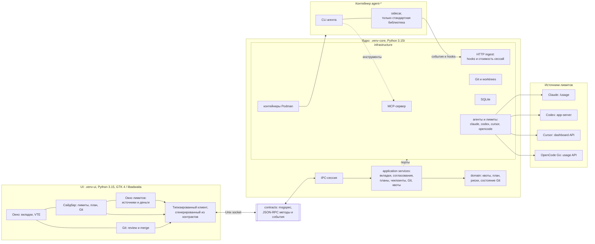

# AConsole

[](https://github.com/secachiss-code/agent_console_p/actions/workflows/check.yml)
[](https://github.com/secachiss-code/agent_console_p/releases)
[](https://github.com/secachiss-code/agent_console_p)
[](https://github.com/secachiss-code/agent_console_p)

**AConsole** — настольная консоль для работы с CLI-агентами. Она запускает Claude Code,
Codex CLI, OpenCode и Cursor CLI в контейнерах Podman, даёт каждой вкладке отдельный Git
worktree и добавляет поверх терминала то, чего обычно не хватает при работе с агентами:
согласования опасных команд, доску планов с MCP-инструментами, чекпоинты, страницу Git для
review и merge, а также панель лимитов и расходов по подпискам.

> **Статус: рабочий прототип.** Проект проверен только на Linux-машине автора. API,
> поведение и формат внутренних данных могут меняться. Это не песочница и не замена
> контейнерной изоляции: агент по-прежнему работает с правами пользователя внутри
> контейнера.

## Возможности

### Проекты и worktree

- Можно добавить любой Git-репозиторий; базовая ветка берётся из его `HEAD`, а не считается
  заранее равной `main`.
- Для вкладки доступны три режима:
  - **новый worktree** — отдельная ветка `ac/<slug>-<id>` и каталог
    `~/.local/share/aconsole/worktrees/<repo>/<tab>`;
  - **основной checkout** — работа прямо в корне проекта;
  - **существующий worktree** — уже созданный каталог.
- В режиме нового worktree у каждой вкладки свой worktree и своя ветка. Это позволяет
  нескольким агентам работать параллельно, не переписывая файлы друг друга.
- При закрытии вкладки с грязным worktree AConsole спрашивает, сохранить его или удалить.
  Чистый worktree, созданный самой AConsole, удаляется; чужие worktree не трогаются.
  `--force` применяется только для отката неудачного создания или после явного
  подтверждения удаления worktree с игнорируемыми файлами (например, `.venv/`).
- Для проекта показываются ahead/behind, staged/unstaged/untracked/conflicted, состояние
  merge/rebase/cherry-pick и preview слияния.

### Агенты и контейнеры

Поддерживаются четыре агента:

| Агент | Команда в контейнере | Контейнер по умолчанию |
|---|---|---|
| Claude Code | `claude` | `agent-claude` |
| Codex CLI | `codex` | `agent-codex` |
| OpenCode | `opencode` | `agent-opencode` |
| Cursor CLI | `agent` | `agent-cursor` |

AConsole **не создаёт контейнеры сама**. Она ожидает существующие контейнеры с именами
`agent-claude`, `agent-codex`, `agent-opencode` и `agent-cursor` (можно создать их через
Distrobox или Podman), при необходимости запускает остановленный контейнер и выполняет
команду через `podman exec` от имени пользователя хоста. Поэтому CLI агента, его логин,
монтирование worktree и vault должны быть настроены внутри контейнера заранее.

Что ещё умеют вкладки:

- продолжить существующую сессию там, где агент это поддерживает: Claude — `--resume`,
  Codex — `codex resume`, OpenCode — `-s <session>`; у Cursor в этой сборке resume нет;
- форкнуть сессию там, где агент это поддерживает (Claude и Codex);
- переименовать, переставить и закрыть вкладку;
- показать статус `starting`, `idle`, `working`, `waiting_approval`, `waiting_input`,
  `error`, `exited` или `unknown`;
- подсветить вкладку, которой нужно внимание, и отправить уведомление.

### Терминал и палитра

- Полноценный терминал VTE с прокруткой, изменением размера, копированием и вставкой,
  поиском по экрану и масштабированием.
- Между VTE и агентом стоит небольшой sidecar на стандартной библиотеке Python: он держит
  PTY, передаёт сигналы и умеет определять «экран затих» для агентов без hooks (OpenCode и
  Cursor).
- Командная палитра (`Ctrl+Shift+P`) ищет команды, навыки агента, узлы планов, заметки
  vault, вкладки, сессии, действия и согласования. У неё есть отдельный шаг аргумента и
  запоминание ранжирования.
- Горячие клавиши можно переопределить в настройках. Основные:

| Клавиши | Действие |
|---|---|
| `Ctrl+Shift+P` | командная палитра |
| `Ctrl+Shift+T` | новая вкладка |
| `Ctrl+Shift+W` | закрыть вкладку |
| `Ctrl+Tab`, `Ctrl+PageDown` | следующая вкладка |
| `Ctrl+Shift+Tab`, `Ctrl+PageUp` | предыдущая вкладка |
| `Alt+1…9` | перейти к вкладке по номеру |
| `Ctrl+Shift+Y` | следующая вкладка, требующая внимания |
| `Ctrl+Shift+Enter` | разрешить согласование |
| `Ctrl+Shift+Backspace` | отклонить согласование |
| `Ctrl+Shift+D` | diff |
| `Ctrl+Shift+G` | страница Git |
| `Ctrl+Shift+F` | поиск в терминале |
| `Ctrl+Shift+C` / `Ctrl+Shift+V` | копировать / вставить |
| `F9`, `Ctrl+Shift+B` | показать или скрыть сайдбар |
| `Ctrl+,` | настройки |
| `Ctrl+?`, `F1` | список горячих клавиш |
| `Ctrl+Q` | выход |

### Согласования

- Claude Code и Codex могут присылать запрос на опасный инструмент (Codex — после того,
  как его hooks доверены). AConsole показывает его в панели согласований: команду,
  рабочий каталог, риск и срок действия.
- Решение можно принять один раз или запомнить для текущей сессии вкладки. Отказ можно
  сопроводить сообщением агенту.
- Запрос можно вернуть агенту в его нативный prompt, если вы хотите решить его в терминале.
- У запроса есть nonce, срок жизни и дедупликация по входным данным; повторный запрос не
  создаёт вторую карточку.
- Команды классифицируются по рискам: `destructive`, `outside_worktree`, `network`,
  `publish`, `secrets`, `privilege`.
- Запомненное разрешение по префиксу — не «любая команда с этим началом». Оно работает
  только для программ и подкоманд из встроенного allowlist, только для «простых» слов без
  раскрытия shell и только пока пути остаются внутри worktree. Всё остальное требует
  точного совпадения.
- OpenCode и Cursor не имеют hooks для inline-согласований, поэтому их запросы остаются
  нативными запросами в терминале.

Согласования — это дополнительный барьер, а не замена изоляции контейнера. Агент всё равно
может изменить любой файл, доступный ему в смонтированном worktree.

### Планы, MCP и база знаний

Ядро AConsole поднимает MCP-сервер на loopback-адресе. Каждая вкладка получает свой
bearer-токен, поэтому инструменты работают в контексте конкретного проекта, worktree и
агента. Агент видит двенадцать инструментов:

| Инструмент | Назначение |
|---|---|
| `plan_create` | создать план; повтор с тем же названием возвращает тот же план |
| `plan_add_nodes` | добавить узлы; существующие ключи не меняются, цикл не добавляется |
| `plan_get` | прочитать план; `response_format=detailed` и `since=<revision>` дают детали или только изменения |
| `plan_ready` | список узлов, которые можно взять в работу, по приоритету |
| `node_claim` | взять lease узла и получить fence для последующих вызовов |
| `node_update` | сменить статус, отправить heartbeat, заметку или evidence |
| `node_attach` | прикрепить commit, file, test_report, url или note |
| `ctx_get` | получить знания по узлу или запросу |
| `kb_add` | записать факт, решение или требование; источник факта должен существовать |
| `kb_impact` | посмотреть, что зависит от цели, по графу кода |
| `handover` | записать или прочитать handover по текущей работе |
| `plan_list` | список планов проекта |

План — это DAG: у узлов есть ключи, зависимости, родитель, связанные узлы, владелец,
пути, критерии приёмки, тестовая команда, флаг review и границы работы. Статусы:
`pending`, `in_progress`, `verifying`, `blocked`, `done`, `failed`, `cancelled`. Узлы
берутся через lease с fence, поэтому два агента не должны незаметно работать над одним
узлом.

Ответы MCP-инструментов сжаты: без отступов, пустых полей и лишних схем. AConsole также
считает, сколько байт ответов инструментов попало в контекст агента, и показывает это в
интерфейсе.

Планы синхронизируются с Obsidian-vault:

- по умолчанию vault — `~/Obsidian/AConsole`;
- узлы плана лежат в `plans/<plan>/<KEY>.md` с YAML frontmatter;
- тело заметки под frontmatter после первой записи принадлежит пользователю;
- при редактировании frontmatter выполняется трёхсторонний merge: принятые поля
  возвращаются на доску планов, отклонённые записываются обратно так, как их видит ядро;
- заметки `facts/<project>-to-review.md` перечисляют факты, код вокруг которых изменился
  после проверки;
- `.obsidian/` не считается источником истины, а ссылки, выходящие за пределы vault, не
  разрешаются.

### Чекпоинты

- Для агентов с hooks (Claude Code и Codex) перед каждым пользовательским промптом
  снимается чекпоинт worktree.
- Чекпоинт — это Git-коммит на отдельной ссылке
  `refs/aconsole/checkpoints/<tab>/<n>`, а не изменение `HEAD` или индекса пользователя.
  Для снимка используется приватный индекс; `git stash` и `git reset --hard` не
  применяются.
- Список чекпоинтов показывает номер, время, label, число файлов и вставок/удалений.
- Перед восстановлением показывается preview с diffstat и списком файлов; восстановление
  требует одноразовый confirm-токен.
- Перед восстановлением создаётся safety-чекпоинт текущего состояния. Восстановление
  затрагивает отслеживаемые и новые файлы worktree, но не игнорируемые (`.gitignore`).
- Пока агент работает, восстановление отклоняется.
- Хранится последние 100 чекпоинтов по умолчанию; значение настраивается от 5 до 500.
- Для OpenCode и Cursor чекпоинты не создаются, потому что у них нет hooks.

### Git

Страница Git — это не просто `git status`:

- состояние worktree и веток, ahead/behind, staged/unstaged/untracked/conflicted;
- граф коммитов и чекпоинтов, включая привязку к плану, агенту и вкладке;
- diff по файлам и хункам, stage/unstage, commit;
- восстановление отдельного файла из коммита с preview и confirm-токеном;
- preview слияния через `git merge-tree` и режимы fast-forward, merge и squash;
- rebase, cherry-pick, continue/abort незавершённой операции;
- удаление worktree с отдельным подтверждением для игнорируемых файлов;
- отправка diff другому агенту во вкладку (с preview и подтверждением);
- список фактов, которые стоит перепроверить после изменений кода.

Коммиты, сделанные через AConsole, получают trailers `AConsole-Node`, `AConsole-Agent` и
`AConsole-Tab`. Это сохраняет связь работы с планом даже после закрытия вкладки и ветки.
Слияние проверяет, что source/target не изменились с момента preview; устаревший preview
не применяется.

### Лимиты и расходы

Сайдбар показывает лимиты по каждому подключённому аккаунту. Окно лимитов умеет
обновляться вручную и объясняет, откуда взято число и когда оно наблюдалось.

| Агент | Окна | Деньги |
|---|---|---|
| Claude | 5 часов, неделя | extra usage, стоимость сессии |
| Codex | 5 часов, неделя, spend limit | баланс кредитов или unlimited |
| Cursor | месяц, в процентах | on-demand pool |
| OpenCode | 5 часов, неделя, месяц | стоимость сессии |

Источники:

- Claude — `/usage` внутри контейнера;
- Codex — `account/rateLimits/read` через `codex app-server`;
- Cursor — dashboard API Cursor;
- OpenCode Go — usage API OpenCode.

Для Cursor и OpenCode используются те же endpoint'ы, что и в их dashboard. Это не
публичные API, их формат может измениться. Порог предупреждения по умолчанию — 80%,
критический — 95%; отображение можно переключить между «использовано» и «осталось».
Токены по моделям Claude и Codex читаются из их локальных session-логов; AConsole хранит
только числа и имена моделей, не содержимое переписки.

### Настройки и проверка окружения

В настройках можно изменить:

- путь к Obsidian-vault и каталогу worktree;
- режим согласований (`inline` или `native`) и время удержания запроса (30–540 секунд);
- уведомления (`unfocused`, `always`, `never`);
- шрифт и размер терминала, scrollback (1 000–200 000 строк);
- тему (`system`, `light`, `dark`);
- пороги квот и отображение used/remaining;
- включение чекпоинтов и их количество;
- переопределения горячих клавиш;
- языки codegraph;
- флаг завершённой настройки.

Мастер первого запуска проверяет:

- `podman` и `distrobox`;
- контейнеры `agent-*`;
- версии CLI и статус логина (Claude проверяется автоматически; для остальных агентов
  результат может требовать ручной проверки);
- каталог vault;
- монтирование worktree и vault в контейнеры;
- инструменты `devtools` (Python, Cargo, .NET, Node);
- `notify-send` и сессионный D-Bus.

Для исправлений показывается preview и требуются явные подтверждение и повторная проверка.
Есть диалог здоровья ядра (очередь записи в БД, ошибки writer, latency IPC, resync) и
проверка перед выходом, если остались занятые вкладки или ожидающие согласования.

## Как это устроено



### Два процесса на двух Python

Ядро требует free-threaded Python (3.15t), а GTK не загружается под ним. Поэтому AConsole
запускает два процесса:

- **UI** — `.venv-ui`, Python 3.15 с GIL, GTK 4, libadwaita и VTE;
- **ядро** — `.venv-core`, Python 3.15t, без GTK.

Они не делят память и общаются только через JSON-RPC по Unix-сокету
`$XDG_RUNTIME_DIR/aconsole/core.sock` (или `~/.local/state/aconsole/core.sock`, если
`XDG_RUNTIME_DIR` не задан). Ядро держит эксклюзивную блокировку, поднимается по требованию
и завершается после простоя; UI может подключиться к уже запущенному ядру.

### Контракты и слои

`src/aconsole/contracts` — единственное, что разделяют UI и ядро. Контракты описаны на
msgspec; из них генерируются типизированный клиент, JSON Schema и OpenAPI для ingest.
Поэтому UI и ядро не могут разойтись в названиях методов и полей незаметно.

Правила слоёв проверяются import-linter:

- UI не импортирует core;
- core не импортирует UI и `gi`;
- domain не импортирует SQLAlchemy, msgspec, MCP, uvicorn, watchdog и subprocess;
- application не импортирует infrastructure;
- contracts не импортирует остальной AConsole;
- sidecar остаётся на стандартной библиотеке.

### Ядро

- **domain** — чистые правила: квоты, план, риски команд, approvals, checkpoints,
  состояние Git, vault sync.
- **application** — сценарии и порты: вкладки, проекты, согласования, чекпоинты, Git,
  review, квоты, setup.
- **infrastructure** — адаптеры: Podman, Git, SQLite, HTTP ingest, MCP, vault, codegraph,
  агенты и их лимиты, fake core для демо.

SQLite хранит проекты, вкладки, настройки, планы, знания, approvals, чекпоинты и
журналы Git-операций; схема поднимается через Alembic. Запись идёт через очередь writer,
а здоровье очереди видно в диалоге здоровья.

HTTP ingest слушает только `127.0.0.1`; у каждой вкладки свой bearer-токен, проверяется
Origin, тело ограничено 1 MiB, очередь событий ограничена и при переполнении сохраняет
последнее состояние вкладки. MCP-сервер живёт на `/mcp` рядом с ingest и использует те же
токены вкладок.

### Sidecar и hooks

Sidecar запускается как `python -m aconsole.sidecar -- <команда агента>` внутри контейнера.
Он:

- создаёт PTY и соединяет его с VTE;
- передаёт `SIGWINCH`, `SIGTERM` и `SIGHUP`;
- отправляет в ядро `started`, `exited`, `stats` и сигналы экрана по NDJSON;
- для Cursor и OpenCode определяет, что терминал затих, и отдаёт последние строки ядра;
- не импортирует контракты, `gi`, `mcp`, `msgspec`, SQLAlchemy или uvicorn — только
  стандартную библиотеку.

Claude и Codex запускаются с настройками hooks, которые указывают на локальный ingest.
Codex дополнительно требует доверия к hooks; до этого его уведомления и MCP работают, а
inline-согласования могут оставаться нативными.

### Демо без агентов

Встроенный fake core позволяет посмотреть интерфейс без Podman и контейнеров:

```sh
.venv-ui/bin/aconsole --fake demo
```

Доступны сценарии `demo`, `empty`, `stress`, `errors`, `waiting`, `quota-critical`,
`approval-expired` и `agents`.

## Требования

| Что | Требование |
|---|---|
| ОС | Linux с X11 или Wayland; проект проверялся только на машине автора |
| GTK | GTK 4.14+, libadwaita 1.5+, VTE 3.91 и их GObject introspection |
| Git | обычный Git; worktree и side refs используются активно |
| Контейнеры | Podman; контейнеры `agent-claude`, `agent-codex`, `agent-opencode`, `agent-cursor` |
| Distrobox | рекомендуется для создания контейнеров и PATH; AConsole не запускает `distrobox assemble` |
| Агенты | CLI установлен и залогинен внутри своего контейнера |
| Python | для запуска из исходников — `uv` и Python 3.15t + 3.15; в `.deb` Python уже внутри |
| Уведомления | `notify-send` и сессионный D-Bus — опционально |
| Codegraph | Python, Cargo, .NET и Node в контейнере `devtools` — опционально |

Пакет `.deb` зависит от `git`, `podman`, `gir1.2-gtk-4.0 (>= 4.14)`,
`gir1.2-adw-1 (>= 1.5)`, `gir1.2-vte-3.91`, `libgirepository-2.0-0`, `libcairo2`,
`libcairo-gobject2` и `libffi8`. Сами CLI агентов в пакет не входят.

## Установка

### Из GitHub Release (.deb)

Готовый пакет для `amd64` лежит в GitHub Releases, а не в Git-репозитории: бинарные
артефакты не стоит коммитить в историю.

- Страница релиза: <https://github.com/secachiss-code/agent_console_p/releases/tag/v0.1.0>
- Прямая ссылка:
  <https://github.com/secachiss-code/agent_console_p/releases/download/v0.1.0/aconsole_0.1.0_amd64.deb>
- Контрольные суммы:
  <https://github.com/secachiss-code/agent_console_p/releases/download/v0.1.0/SHA256SUMS>

```sh
wget https://github.com/secachiss-code/agent_console_p/releases/download/v0.1.0/aconsole_0.1.0_amd64.deb
sha256sum aconsole_0.1.0_amd64.deb
# f383725cc06f9cd11488f841dc82d78579f17fad69926ec9400bab648d8af53b

sudo apt install ./aconsole_0.1.0_amd64.deb
aconsole
```

Пакет ставит:

- `/usr/bin/aconsole` — UI;
- `/usr/bin/aconsoled` — ядро;
- собственные Python 3.15t и 3.15 под `/opt/aconsole`;
- `.desktop`-файл и иконки.

Системными остаются GTK, libadwaita, VTE, Git, Podman и драйверы. Пакет собран для
Debian/Ubuntu на `amd64`; для других архитектур и дистрибутивов нужна отдельная сборка.
Пакет не подписан GPG — сверяйте SHA256.

Данные пользователя по умолчанию лежат в `~/.local/share/aconsole` (или в
`$XDG_DATA_HOME/aconsole`); установка и удаление пакета их не удаляют. Для удаления:

```sh
sudo apt remove aconsole
```

### Из исходников

Нужны GTK-зависимости, Git, Podman и `uv`. Пример для Debian/Ubuntu:

```sh
sudo apt install gir1.2-gtk-4.0 gir1.2-adw-1 gir1.2-vte-3.91 \
  libgirepository-2.0-dev libcairo2-dev git podman
```

Установите оба Python и соберите окружения:

```sh
uv python install 3.15t 3.15
./install.sh
.venv-ui/bin/aconsole
```

`install.sh`:

- синхронизирует `.venv-core` и `.venv-ui` из `uv.lock`;
- проверяет, что core действительно free-threaded, а UI — с GIL;
- добавляет ярлык и иконки в `~/.local/share/applications` и `~/.local/share/icons`;
- не устанавливает системные пакеты и не повышает привилегии.

Если checkout находится вне `$HOME`, нужен флаг `--allow-outside-home`. Посмотреть, что
будет сделано, можно через `./install.sh --dry-run`.

Запуск без установки ярлыка:

```sh
.venv-ui/bin/aconsole
```

Демо-режим без Podman:

```sh
.venv-ui/bin/aconsole --fake demo
```

Ядро можно запустить отдельно:

```sh
.venv-core/bin/aconsoled --serve
```

Но обычно UI сам поднимает его через Unix-сокет.

## Первый запуск

1. **Проверьте окружение.** Мастер настройки покажет результаты проверок и предложит
   исправимые действия. Если контейнеров `agent-*` нет, их нужно создать.
2. **Подготовьте контейнеры.** AConsole не создаёт их. Имена по умолчанию:
   `agent-claude`, `agent-codex`, `agent-opencode`, `agent-cursor`. В каждом должен быть
   установлен и залогинен соответствующий CLI. Каталог worktree и vault должен быть
   смонтирован в контейнер по тому же пути, что и на хосте.
3. **Добавьте проект.** Укажите корень Git-репозитория. AConsole возьмёт базовую ветку из
   `HEAD` и покажет проект в сайдбаре.
4. **Создайте вкладку.** Выберите агента, режим worktree, базовую ветку и, если нужно,
   узел плана или существующую сессию.
5. **Работайте.** Агент живёт в терминале; согласования, план, чекпоинты, Git и лимиты
   доступны в сайдбаре и на отдельных страницах.
6. **Закройте вкладку.** Если worktree грязный, AConsole предложит сохранить или удалить
   его. Для worktree, созданного вручную, удаление не предлагается.

Если что-то не работает:

- `agent-* container not found` — создайте контейнер или проверьте имя;
- агент не залогинен — залогиньтесь в его CLI внутри контейнера;
- нет лимитов — проверьте логин и обновите окно лимитов; endpoint'ы Cursor и OpenCode
  могут меняться;
- нет уведомлений — установите `notify-send` и проверьте `DBUS_SESSION_BUS_ADDRESS`;
- `AF_UNIX path too long` в тестах — передайте короткий `--basetemp`;
- ядро отказывается стартовать с сообщением про GIL — вы запустили его не тем Python;
  используйте `.venv-core` (free-threaded) для ядра и `.venv-ui` для UI.

## Типичный цикл работы

1. Добавьте проект и создайте вкладку с новым worktree.
2. Сформулируйте задачу агенту в терминале.
3. Следите за статусом: `working`, `waiting_approval`, `waiting_input`.
4. Разрешайте или отклоняйте опасные команды; при необходимости запоминайте префикс.
5. Если агент использует MCP, смотрите план в сайдбаре: узлы, зависимости и прогресс.
6. Перед рискованным изменением вернитесь к чекпоинту или создайте новый.
7. Откройте diff, проверьте изменения, сделайте commit.
8. Слейте ветку в базовую через preview и выбранный режим.
9. Проверьте лимиты и стоимость сессии, чтобы не упереться в квоту.

## Проверки и тесты

Линтеры, типы, слои и контракты:

```sh
tools/check.sh
```

Он запускает `ruff`, `basedpyright` в режиме `all`, `import-linter`, проверки на отсутствие
JS и raw SQL, контрастность, соответствие контрактам и API floor.

Тесты ядра и контрактов:

```sh
.venv-core/bin/python -m pytest tests/core tests/contracts tests/unit tests/gate \
  tests/hostrun tests/smoke tests/test_package.py tests/test_contrast.py
```

Тесты интерфейса:

```sh
xvfb-run -a .venv-ui/bin/python -m pytest tests/gui tests/ui tests/smoke
```

`tests/unit` и тест прокрутки в `tests/gui/front/test_git_scale_ui.py` содержат лимиты
времени, измеренные на одной 8-ядерной машине, поэтому CI их не запускает. В CI также
исключён `test_scrolling_a_long_history`.

Если тесты падают с `AF_UNIX path too long`, передайте короткий `--basetemp`:

```sh
.venv-core/bin/python -m pytest ... --basetemp=/tmp/ac-core
```

Планы и документы API лежат в отдельном репозитории и подключаются как `docs/`. Без него
проверки, сверяющие код с документами, пропускаются и сообщают об этом.

Для замеров есть отдельные инструменты: `tools/git_bench.py`, `tools/git_snapshot.py`,
`tools/mcp_bench.py` и `tools/ui_rss.py`.

## Структура репозитория

| Путь | Что там |
|---|---|
| `src/aconsole/contracts` | JSON-RPC-контракты, схемы и генерация клиента |
| `src/aconsole/core/domain` | чистые правила: квоты, план, риски, Git, approvals, checkpoints |
| `src/aconsole/core/application` | сценарии и порты: вкладки, проекты, Git, review, квоты, setup |
| `src/aconsole/core/infrastructure` | Podman, Git, SQLite, HTTP ingest, MCP, vault, codegraph, агенты, fake core |
| `src/aconsole/ui` | GTK-интерфейс: views, viewmodels, logic, client |
| `src/aconsole/sidecar` | PTY-помощник на стандартной библиотеке |
| `src/aconsole/devcli` | CLI-клиент и проверка соответствия MCP |
| `migrations` | миграции Alembic |
| `packaging` | `.desktop`, иконки и `build_deb.py` |
| `contracts/schema` | сгенерированные JSON Schema и OpenAPI для ingest |
| `tools` | проверки, gate, hostrun, бенчмарки |
| `tests` | core, contracts, gui, ui, smoke, gate, hostrun, unit |
| `spikes` | исследовательские прототипы |
| `stubs` | заглушки типов |
| `.github/workflows/check.yml` | CI на Ubuntu 24.04 |
| `install.sh` | сборка двух окружений и ярлык |
| `pyproject.toml` | зависимости, правила слоёв и проверок |
| `dist/` | локальная сборка `.deb`; в Git не коммитится |

## Ограничения

- Это прототип, а не готовый продукт с обещанием стабильного API.
- Поддерживается Linux; Windows и macOS не тестировались.
- AConsole не управляет созданием контейнеров и не устанавливает CLI агентов.
- У OpenCode и Cursor нет hooks, поэтому inline-согласования и чекпоинты работают не для
  всех агентов; их статус определяется по экрану.
- Cursor и OpenCode отдают лимиты через непубличные endpoint'ы; формат может сломаться.
- Однопользовательский режим: нет серверного/multi-user развёртывания.
- Пакет собран только для `amd64` и не подписан GPG.
- В репозитории нет файла `LICENSE`; условия распространения нужно определить отдельно.
- Согласования и allowlist — это защитные барьеры, а не песочница. Не давайте агенту
  доступ к тому, что не готовы потерять.

## Ссылки

- Репозиторий: <https://github.com/secachiss-code/agent_console_p>
- Релизы: <https://github.com/secachiss-code/agent_console_p/releases>
- CI: <https://github.com/secachiss-code/agent_console_p/actions/workflows/check.yml>
- Issues: <https://github.com/secachiss-code/agent_console_p/issues>
