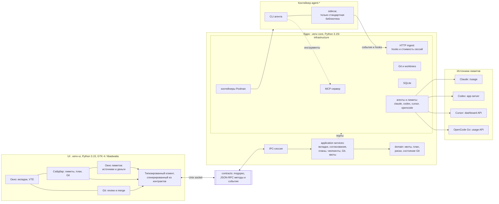

# AConsole

**AConsole** — настольная консоль для работы с CLI-агентами. Она запускает Claude Code,
Codex CLI, OpenCode и Cursor CLI в контейнерах Podman, объединяет исполнителей в рабочие
сессии задач и добавляет поверх терминала то, чего обычно не хватает: согласования опасных
команд, доску планов с MCP-инструментами, чекпоинты, страницу Git для review и merge,
а также панель лимитов и расходов по подпискам.

[](https://github.com/secachiss-code/agent_console_p/actions/workflows/check.yml)
[](https://github.com/secachiss-code/agent_console_p/releases)
[](https://github.com/secachiss-code/agent_console_p)
[](https://github.com/secachiss-code/agent_console_p)

> **Статус: рабочий прототип.** Проверен только на Linux-машине автора. API, поведение и
> формат внутренних данных могут меняться. Это не песочница и не замена контейнерной
> изоляции: агент работает с правами пользователя внутри контейнера.

## Версия

| Что | Значение |
|---|---|
| Версия | **0.1.1 «Работа с Git»**, опубликована 2026-11-06 |
| Тег и коммит | `v0.1.1`, `45152a1` |
| API контрактов | `1.4.0`, протокол IPC `1.0` |
| Пакет | `aconsole_0.1.1_amd64.deb`, 67 586 408 байт, SHA-256 `23b001936f03cc2f15c9ffdcc6fbc0b68235d212b817eea8e8bf44a2ded2de16` |

Версия в `pyproject.toml`, `src/aconsole/__init__.py` и ответе ядра — `0.1.1`.
Предыдущий релиз — `0.1.0` (2026-11-04). История версий — в [CHANGELOG.md](CHANGELOG.md).

## Возможности

### Проекты, сессии задач и worktree

- Можно добавить любой Git-репозиторий; базовая ветка берётся из его `HEAD`, а не считается
  заранее равной `main`.
- Рабочая сессия (`WorkSession`) владеет основной копией, веткой и историей задачи.
  Это отдельная сущность от нативного диалога CLI (`agent_session_id`).
- Для основной копии сессии доступны три режима:
  - **новый worktree** — отдельная ветка `ac/s-<slug>-<id>` и каталог
    под `~/.local/share/aconsole/worktrees/<repo>/`;
  - **основной checkout** — работа прямо в корне проекта;
  - **существующий worktree** — уже созданный каталог.
- Несколько вкладок могут исполнять одну задачу последовательно. В общем каталоге
  запускается один агент; действие «Передать управление» останавливает прежнего,
  проверяет процессы и сохраняет снимок. Простое переключение вкладок право записи
  не передаёт. Если остановку подтвердить нельзя, запуск следующего блокируется.
- Добавление второго агента сохраняет новую вкладку даже при занятой общей копии.
  Во вкладке показывается ожидание и кнопка «Передать управление» с подтверждением.
- Для параллельной работы выберите изолированного исполнителя: он получает detached
  worktree от HEAD сессии. Его сохранённый результат принимается сначала в сессию,
  затем вся сессия сливается в базовую ветку.
- Закрытие вкладки сохраняет рабочие копии и историю. Архивирование сессии останавливает
  её агентов; сессию с сохранённой основной копией можно возобновить.
- Удаление управляемой копии выполняется отдельно после слияния и проверок Git.
  Основной checkout и импортированные worktree не удаляются. После squash исходные
  коммиты удерживаются ref. История остаётся после удаления основной копии, но такую
  сессию возобновить нельзя. Копии изолированных исполнителей очищаются отдельно.
- При очистке проверяются новые коммиты, dirty и ignored файлы. Незакоммиченные файлы
  исполнителя могут быть приняты снимком; его грязная копия при этом сохраняется.
- Для проекта показываются ahead/behind, staged/unstaged/untracked/conflicted, состояние
  merge/rebase/cherry-pick и preview слияния.

### Агенты и контейнеры

Поддерживаются четыре агента:

| Агент | Команда в контейнере | Контейнер по умолчанию |
|---|---|---|
| Claude Code | `claude` | `agent-claude` |
| Codex CLI | `codex` | `agent-codex` |
| OpenCode | `opencode` | `agent-opencode` |
| Cursor CLI | `agent` | `agent-cursor` |

AConsole **не создаёт контейнеры сама**. Она ожидает существующие контейнеры с именами
`agent-claude`, `agent-codex`, `agent-opencode` и `agent-cursor` (можно создать их через
Distrobox или Podman), при необходимости запускает остановленный контейнер и выполняет
команду через `podman exec` от имени пользователя хоста. Поэтому CLI агента, его логин,
монтирование worktree и vault должны быть настроены внутри контейнера заранее.

> **Изоляция контейнеров:** мастер и окно диагностики проверяют монтирования
> агентов и devtools. Общий HOME открывает агенту базу AConsole, секреты и файлы
> запуска хоста. Предупреждение не меняет контейнеры автоматически.
> [Рекомендуемая конфигурация и проверка](#container-isolation-sec-7).

<a id="container-isolation-sec-7"></a>
### Container isolation (SEC-7)

Рекомендуемый минимум — отдельный HOME внутри контейнера и bind-доступ только
к рабочим копиям и vault. Не монтируйте весь HOME, каталог данных AConsole,
`.config`, `.ssh`, `.aws`, файлы shell-профилей, пользовательские systemd units,
Podman/Docker sockets, hostrun socket, host-bins или `/run/host`.
Read-only HOME тоже раскрывает данные; смена HOME внутри контейнера не отменяет
доступ к прежнему HOME через другой mount. Distrobox с интеграцией хоста и
одним `--home` не является проверенной изолированной конфигурацией.

Перед изменениями остановите агентов, сохраните их сессии и настройки входа,
просмотрите `podman inspect --format '{{json .Mounts}}' agent-claude` и аналогичные
выводы остальных агентов и devtools. Новую конфигурацию создаёт пользователь;
AConsole не пересоздаёт контейнеры и не переносит секреты автоматически.

Пример **шаблона** отдельного rootless Podman-контейнера (не команда миграции):
образ `YOUR_AGENT_IMAGE` должен содержать CLI, `/bin/sh`, пользователя с именем
и UID пользователя хоста, а также рабочий HOME этого пользователя.
Замените имя контейнера, образ и пути на выбранные вами. Отдельный новый контейнер
не заменит используемый приложением `agent-claude`, пока вы явно не переключите его.

```bash
podman create --name agent-claude-isolated --userns=keep-id \
  --user "$(id -u):$(id -g)" --cap-drop=all \
  --security-opt=no-new-privileges \
  --mount "type=bind,src=$HOME/.local/share/aconsole/worktrees,dst=$HOME/.local/share/aconsole/worktrees" \
  --mount "type=bind,src=$HOME/Obsidian/AConsole,dst=$HOME/Obsidian/AConsole" \
  YOUR_AGENT_IMAGE sleep infinity
```

Если используется `XDG_DATA_HOME` или иной путь к workspace/vault, замените пути
на фактические и сохраните их одинаковыми на хосте и в контейнере. Не добавляйте
общий родительский каталог ради короткой записи. Вход CLI и его конфигурация
должны храниться в отдельном HOME; настройки host-exec не переносите.
Rootless режим, bind mounts, keep-id и no-new-privileges описаны в
[документации Podman](https://docs.podman.io/en/latest/markdown/podman-create.1.html).

После ручного запуска нового контейнера проверьте его mounts и без записи
проверьте, что агент не видит настоящие файлы хоста через их прежние пути:

```bash
podman inspect --format '{{json .Mounts}}' agent-claude-isolated
podman exec --user "$USER" agent-claude-isolated test ! -e "$HOME/.local/share/aconsole/aconsole.db"
podman exec --user "$USER" agent-claude-isolated test ! -e "$HOME/.config/systemd/user"
```

При отдельном HOME путь `$HOME/.bashrc` внутри контейнера может существовать:
это должен быть контейнерный файл, а не файл хоста. Проверяйте соответствие
Source/Destination, включая mounts из containers.conf и дополнительные пути
доступа. Не пытайтесь подтвердить изоляцию записью в настоящую базу или профили.
Проверьте также отсутствие привилегированного режима и host PID namespace.
В мастере выполните диагностику заново; в окне состояния нажмите
«Проверить монтирования контейнеров». Ошибка inspect считается неизвестной
изоляцией. Проверка mounts выявляет известные опасные пути, но не является
полным аудитом образа, привилегий, IPC и ядра ОС.

Изолированная конфигурация намеренно не предоставляет прямой host-exec и
доступ к hostrun. Для devtools нужны отдельно согласованные workspace и дисплей;
общий HOME не требуется. До независимого проверяющего из GATE-1 агентский
hostrun gate выдаёт только диагностический UNVERIFIED (SEC-4).

Что ещё умеют вкладки:

- выбрать в новой вкладке режим рабочей копии, базовую ветку для нового worktree
  и узел активного плана проекта. Пока вкладка открывается, показан индикатор;
  после ошибки введённые значения сохраняются;
- убрать проект из списка кнопкой рядом с выбором проекта после закрытия его вкладок.
  Репозиторий и рабочие копии остаются на диске, проект можно добавить снова;
- продолжить существующую сессию там, где агент это поддерживает: Claude — `--resume`,
  Codex — `codex resume`, OpenCode — `-s <session>`; у Cursor в этой сборке resume нет;
  в диалоге новой вкладки CLI-сессия выбирается отдельно от рабочей сессии задачи.
  Claude/Codex читаются из метаданных выбранного проекта и его рабочих копий;
  для списка OpenCode нужен работающий сервер, созданный этим ядром.
  При отсутствии ID/файла сессии «Продолжить» не запускает новую беседу молча.
- форкнуть сессию через меню вкладки там, где агент это поддерживает (Claude и Codex).
  Ожидающий fork сохраняется при рестарте ядра; после сообщения нового ID вкладка
  продолжает дочернюю беседу. Пока ID исходной сессии неизвестен, fork недоступен;
- переименовать, переставить и закрыть вкладку;
- показать статус `starting`, `idle`, `working`, `waiting_approval`, `waiting_input`,
  `error`, `exited` или `unknown`. Надёжность статусов на реальных CLI и фикстурах
  OpenCode/Cursor ещё проверяется в 0.1.2 (HAR-4);
- подсветить вкладку, которой нужно внимание, и отправить уведомление.

### Терминал и палитра

- Полноценный терминал VTE с прокруткой, изменением размера, копированием и вставкой,
  поиском по экрану и масштабированием.
- Между VTE и агентом стоит небольшой sidecar на стандартной библиотеке Python: он держит
  PTY, передаёт сигналы и умеет определять «экран затих». Сейчас это подключено для
  Cursor; подключение и реальные фикстуры OpenCode остаются в HAR-4.
- Командная палитра (`Ctrl+Shift+P`) ищет команды, навыки агента, узлы планов, заметки
  vault, вкладки, сессии, действия и согласования. У неё есть отдельный шаг аргумента и
  запоминание ранжирования. Маршруты `palette/*` подключены к настоящему ядру;
  доступность конкретного действия зависит от возможностей выбранного агента и контекста.
- Горячие клавиши применяют `keymap_overrides` из RPC-настроек; редактора сочетаний
  в окне настроек пока нет. Основные:

| Клавиши | Действие |
|---|---|
| `Ctrl+Shift+P` | командная палитра |
| `Ctrl+Shift+T` | новая вкладка |
| `Ctrl+Shift+W` | закрыть вкладку |
| `Ctrl+Tab`, `Ctrl+PageDown` | следующая вкладка |
| `Ctrl+Shift+Tab`, `Ctrl+PageUp` | предыдущая вкладка |
| `Alt+1…9` | перейти к вкладке по номеру |
| `Ctrl+Shift+Y` | следующая вкладка, требующая внимания |
| `Ctrl+Shift+Enter` | разрешить согласование |
| `Ctrl+Shift+Backspace` | отклонить согласование |
| `Ctrl+Shift+D` | diff |
| `Ctrl+Shift+G` | страница Git |
| `Ctrl+Shift+F` | поиск в терминале |
| `Ctrl+Shift+C` / `Ctrl+Shift+V` | копировать / вставить |
| `F9`, `Ctrl+Shift+B` | показать или скрыть сайдбар |
| `Ctrl+,` | настройки |
| `Ctrl+?`, `F1` | список горячих клавиш |
| `Ctrl+=`, `Ctrl+Alt+-`, `Ctrl+0` | крупнее, мельче, обычный текст терминала |
| `Ctrl+Q` | выход |

### Согласования

- Claude Code и Codex могут присылать запрос на опасный инструмент. Для Codex AConsole
  сначала проверяет определения и доверие hooks через установленный CLI. После успешной
  проверки запрос показывается карточкой выбранной вкладки поверх главного окна: команда,
  рабочий каталог, риск и срок действия. Кнопки решения остаются видимыми, детали
  прокручиваются отдельно. Панель пока видна и на странице Git/review; перенос
  исключительно в терминал остаётся в APR-1.
- По умолчанию, если окно или вкладка не в фокусе, приходит системное уведомление; клик открывает
  вкладку с запросом. На один эпизод создаётся одно уведомление, при решении оно
  отзывается. RPC-настройка `notify_when` позволяет выбрать `always` или `never`.
- Решение можно принять один раз или запомнить для текущей сессии вкладки. Отказ можно
  сопроводить сообщением агенту. Разовый `ALLOW` не разрешает независимый повторный
  вызов с теми же входными данными.
- Запрос можно вернуть агенту в его нативный prompt, если вы хотите решить его в терминале.
- У запроса есть nonce, срок жизни и дедупликация по входным данным; повторная доставка
  того же события не создаёт вторую карточку.
- Команды классифицируются по рискам: `destructive`, `outside_worktree`, `network`,
  `publish`, `secrets`, `privilege`. Команды, которые разбор не понял, считаются
  рискованными.
- Запомненное разрешение по префиксу — не «любая команда с этим началом». Оно работает
  только для программ и подкоманд из встроенного allowlist, только для «простых» слов без
  раскрытия shell и только пока пути остаются внутри worktree. Всё остальное требует
  точного совпадения.
- Для `Write`, `Edit` и MCP-вызовов в текущей сборке показываются не все детали: путь,
  diff и аргументы инструмента ещё не выводятся полностью. Полный просмотр и пометка
  рискованных путей — 0.1.2 (APR-2).
- Сейчас настраивается только место вопроса (`inline` или `native`) и разовые/сессионные
  решения. Режимы «спрашивать», «разрешать» и «запрещать», их подрежимы и уровни
  «глобально/проект» появятся в 0.1.2 (APR-4…APR-9).
- OpenCode и Cursor не имеют hooks для inline-согласований, поэтому их запросы остаются
  нативными запросами в терминале. Честная матрица возможностей и перехват для этих
  harness'ов — 0.1.2 (APR-6…APR-8).

Согласования — это дополнительный барьер, а не замена изоляции контейнера. Агент всё равно
может изменить любой файл, доступный ему в смонтированном worktree.

### Планы, MCP и база знаний

Ядро AConsole поднимает MCP-сервер на loopback-адресе. Каждая вкладка получает свой
bearer-токен, поэтому инструменты работают в контексте конкретного проекта, worktree и
агента. Агент видит двенадцать инструментов:

| Инструмент | Назначение |
|---|---|
| `plan_create` | создать план; повтор с тем же названием возвращает тот же план |
| `plan_add_nodes` | добавить узлы; существующие ключи не меняются, цикл не добавляется |
| `plan_get` | прочитать план; `response_format=detailed` и `since=<revision>` дают детали или только изменения |
| `plan_ready` | список узлов, которые можно взять в работу, по приоритету |
| `node_claim` | взять lease узла и получить fence для последующих вызовов |
| `node_update` | сменить статус, отправить heartbeat, заметку или evidence |
| `node_attach` | прикрепить commit, file, test_report, url или note |
| `ctx_get` | получить знания по узлу или запросу |
| `kb_add` | записать факт, решение или требование; источник факта должен существовать |
| `kb_impact` | посмотреть, что зависит от цели, по графу кода |
| `handover` | записать или прочитать handover по текущей работе |
| `plan_list` | список планов проекта |

План — это DAG: у узлов есть ключи, зависимости, родитель, связанные узлы, владелец,
пути, критерии приёмки, тестовая команда, флаг review и границы работы. Статусы:
`pending`, `in_progress`, `verifying`, `blocked`, `done`, `failed`, `cancelled`. Узлы
берутся через lease с fence, поэтому два агента не должны незаметно работать над одним
узлом.

Ответы MCP-инструментов сжаты: без отступов, пустых полей и лишних схем. AConsole также
считает, сколько байт ответов инструментов попало в контекст агента, и показывает это в
интерфейсе.

Планы синхронизируются с Obsidian-vault:

- по умолчанию vault — `~/Obsidian/AConsole`;
- узлы плана лежат в `plans/<plan>/<KEY>.md` с YAML frontmatter;
- тело заметки под frontmatter после первой записи принадлежит пользователю;
- при редактировании frontmatter выполняется трёхсторонний merge: принятые поля
  возвращаются на доску планов, отклонённые записываются обратно так, как их видит ядро;
- заметки `facts/<project>-to-review.md` перечисляют факты, код вокруг которых изменился
  после проверки;
- `.obsidian/` не считается источником истины, а ссылки, выходящие за пределы vault, не
  разрешаются.

### Чекпоинты

- Для Claude Code перед каждым пользовательским промптом снимается чекпоинт worktree.
  Для Codex автоматические чекпоинты включаются после успешной проверки hooks.
- История сессии хранит начало этапа, передачу управления, результат и защитные снимки
  на `refs/aconsole/sessions/<sid>/checkpoints/<seq>`. Старые чекпоинты и ссылки
  `refs/aconsole/checkpoints/<tab>/<n>` сохраняются при миграции.
  Снимок не изменяет `HEAD` или индекс пользователя.
  Для снимка используется приватный индекс; `git stash` и `git reset --hard` не
  применяются.
- Список чекпоинтов показывает номер, время, label, число файлов и вставок/удалений.
- Перед восстановлением показывается preview с diffstat и списком файлов; восстановление
  требует одноразовый confirm-токен.
- Перед восстановлением создаётся safety-чекпоинт текущего состояния. Восстановление
  затрагивает отслеживаемые и новые файлы worktree, но не игнорируемые (`.gitignore`).
- Восстановление файлов через историю сессии сначала останавливает её исполнителей
  и сохраняет защитный снимок. HEAD и обычный индекс остаются прежними.
- История сессий не очищается автоматически. Ограничение 5–500 (по умолчанию 100)
  относится к прежнему списку чекпоинтов вкладки.
- OpenCode и Cursor участвуют в снимках жизненного цикла сессии; автоматических
  снимков перед каждым промптом у них нет, поскольку отсутствуют hooks.

### Git

Страница Git — это не просто `git status`:

- проектный обзор и выбор сессии, её участники и история этапов;
- состояние worktree и веток, ahead/behind, staged/unstaged/untracked/conflicted;
- граф коммитов и чекпоинтов, включая привязку к плану, агенту и вкладке;
- diff по файлам и хункам, stage/unstage, commit;
- восстановление отдельного файла из коммита с preview и confirm-токеном;
- preview слияния через `git merge-tree` и режимы fast-forward, merge и squash;
- rebase, cherry-pick, continue/abort незавершённой операции;
- удаление worktree с отдельным подтверждением для игнорируемых файлов;
- отправка diff другому агенту во вкладку (с preview и подтверждением);
- список фактов, которые стоит перепроверить после изменений кода.

Коммиты, сделанные через AConsole, получают `AConsole-Session` и доступные trailers
узла, агента и вкладки. Для нескольких исполнителей финальное слияние сохраняет список
участников и узлов, не назначая последнего агента автором всей задачи. Коммиты внешнего
CLI допустимы без trailers; точное авторство строк приложение не выводит из Git.
Слияние проверяет, что source/target не изменились с момента preview; устаревший preview
не применяется.

### Лимиты и расходы

Сайдбар показывает лимиты по каждому подключённому аккаунту. Окно лимитов умеет
обновляться вручную и объясняет, откуда взято число и когда оно наблюдалось.

| Агент | Окна | Деньги |
|---|---|---|
| Claude | 5 часов, неделя | extra usage, стоимость сессии |
| Codex | 5 часов, неделя, spend limit | баланс кредитов или unlimited |
| Cursor | месяц, в процентах | on-demand pool |
| OpenCode | 5 часов, неделя, месяц | стоимость сессии |

Источники:

- Claude — `/usage` внутри контейнера;
- Codex — `account/rateLimits/read` через `codex app-server`;
- Cursor — dashboard API Cursor;
- OpenCode Go — usage API OpenCode.

Для Cursor и OpenCode используются те же endpoint'ы, что и в их dashboard. Это не
публичные API, их формат может измениться. Порог предупреждения по умолчанию — 80%,
критический — 95%; оба порога настраиваются в окне настроек. Они применяются к доле
использованной квоты независимо от отображения «использовано» или «осталось».
Токены по моделям Claude и Codex читаются из их локальных session-логов; AConsole хранит
только числа и имена моделей, не содержимое переписки.

### Настройки и проверка окружения

В окне настроек можно изменить:

- место согласований (`inline` или `native`) и время удержания запроса (30–540 секунд);
- шрифт и размер терминала, scrollback (1 000–200 000 строк);
- тему (`system`, `light`, `dark`);
- пороги предупреждения/критического уровня квот и отображение used/remaining.

Изменения применяются кнопкой «Применить». При закрытии изменённой формы можно
сохранить правки, отменить их или продолжить редактирование. Выход из приложения
также сначала требует решить судьбу черновика. Внешнее обновление
не стирает введённые значения; при ошибке сохранения черновик остаётся в форме.

Дополнительные поля доступны через `settings/get` / `settings/update`, но не имеют
редактора в окне: `vault_path`, `worktrees_dir`, `notify_when`, `checkpoints_enabled`,
`checkpoints_keep`, `keymap_overrides`, `codegraph_languages`, `setup_completed`.
Нужно передавать актуальную `rev`. Новый каталог worktree применяется после перезапуска
ядра и не перемещает существующие копии. Выключение автоматических чекпоинтов не
отменяет защитные снимки перед восстановлением и снимки жизненного цикла сессии.
`checkpoints_keep` относится к прежнему списку чекпоинтов вкладки, не к истории WorkSession.
`codegraph_languages` включает/отключает существующие индексаторы Python, Rust и
TypeScript; изменение набора сбрасывает их кэш. Имя `csharp` сохранено для совместимости,
но автоматического C#-индексатора в этой сборке нет.

Мастер первого запуска проверяет:

- `podman` и `distrobox`;
- контейнеры `agent-*`;
- версии CLI и статус логина (Claude проверяется автоматически; для остальных агентов
  результат может требовать ручной проверки);
- каталог vault;
- монтирование worktree и vault в контейнеры;
- инструменты `devtools` (Python, Cargo, .NET, Node);
- `notify-send` и сессионный D-Bus.

Для исправлений показывается preview и требуются явные подтверждение и повторная проверка.
Есть диалог здоровья ядра (очередь записи в БД, ошибки writer, latency IPC, resync).
При занятых вкладках или ожидающих согласованиях выход через закрытие окна и Ctrl+Q
требует подтверждения. Закрытие работающей вкладки также требует подтверждения.
Неизвестная изоляция или невозможность остановить процессы не считаются успехом.

## Как это устроено



### Два процесса на двух Python

Ядро требует free-threaded Python (3.15t), а GTK не загружается под ним. Поэтому AConsole
запускает два процесса:

- **UI** — `.venv-ui`, Python 3.15 с GIL, GTK 4, libadwaita и VTE;
- **ядро** — `.venv-core`, Python 3.15t, без GTK.

Они не делят память и общаются только через JSON-RPC по Unix-сокету
`$XDG_RUNTIME_DIR/aconsole/core.sock` (или `~/.local/state/aconsole/core.sock`, если
`XDG_RUNTIME_DIR` не задан). Ядро держит эксклюзивную блокировку, поднимается по требованию
и завершается после простоя; UI может подключиться к уже запущенному ядру.

### Контракты и слои

`src/aconsole/contracts` — единственное, что разделяют UI и ядро. Контракты описаны на
msgspec; из них генерируются типизированный клиент, JSON Schema и OpenAPI для ingest.
Поэтому UI и ядро не могут разойтись в названиях методов и полей незаметно.

Правила слоёв проверяются import-linter:

- UI не импортирует core;
- core не импортирует UI и `gi`;
- domain не импортирует SQLAlchemy, msgspec, MCP, uvicorn, watchdog и subprocess;
- application не импортирует infrastructure;
- contracts не импортирует остальной AConsole;
- sidecar остаётся на стандартной библиотеке.

### Ядро

- **domain** — чистые правила: квоты, план, риски команд, approvals, checkpoints,
  состояние Git, vault sync.
- **application** — сценарии и порты: вкладки, проекты, согласования, чекпоинты, Git,
  review, квоты, setup.
- **infrastructure** — адаптеры: Podman, Git, SQLite, HTTP ingest, MCP, vault, codegraph,
  агенты и их лимиты, fake core для демо.

SQLite хранит проекты, вкладки, настройки, планы, знания, approvals, чекпоинты и
журналы Git-операций; схема поднимается через Alembic. Запись идёт через очередь writer,
а здоровье очереди видно в диалоге здоровья.

HTTP ingest слушает только `127.0.0.1`; у каждой вкладки свой bearer-токен, проверяется
Origin, тело ограничено 1 MiB, очередь событий ограничена и при переполнении сохраняет
последнее состояние вкладки. MCP-сервер живёт на `/mcp` рядом с ingest и использует те же
токены вкладок.

### Sidecar и hooks

Sidecar запускается как `python -m aconsole.sidecar -- <команда агента>` внутри контейнера.
Он:

- создаёт PTY и соединяет его с VTE;
- передаёт `SIGWINCH`, `SIGTERM` и `SIGHUP`;
- отправляет в ядро `started`, `exited`, `stats` и сигналы экрана по NDJSON;
- определяет, что терминал затих, и отдаёт последние строки ядра; сейчас это подключено
  для Cursor, для OpenCode подключение ещё проверяется в HAR-4;
- не импортирует контракты, `gi`, `mcp`, `msgspec`, SQLAlchemy или uvicorn — только
  стандартную библиотеку.

Claude и Codex запускаются с настройками интеграции с локальным ingest. Перед запуском
Codex AConsole дважды обращается к `codex app-server`: получает `hooks/list`, сверяет
семь собственных hooks и добавляет их индивидуальные хэши в `hooks.state`,
затем проверяет статус `trusted`. Постоянный `~/.codex/config.toml` не изменяется,
пользовательские и проектные hooks не получают доверия от AConsole.

До успешной проверки Codex не заявляет возможности `hooks`, `approvals` и `checkpoints`.
Если CLI не ответил или определения не совпали, Codex запускается с MCP и notify без
hooks AConsole. Уведомление объясняет: нужно открыть `/hooks` в Codex, проверьте настройки
hooks и ограничения администратора, затем перезапустите агента в AConsole.
Согласования в этом случае остаются в терминале, автоматические чекпоинты отключены.

### Демо без агентов

Встроенный fake core позволяет посмотреть интерфейс без Podman и контейнеров:

```sh
.venv-ui/bin/aconsole --fake demo
```

Доступны сценарии `demo`, `empty`, `stress`, `errors`, `waiting`, `quota-critical`,
`approval-expired` и `agents`.

## Планируется в 0.1.2

0.1.2 — следующая версия после завершения `plan-1`. Она не выпущена; версия в
`pyproject.toml` пока остаётся `0.1.1`. Основные направления:

- **Безопасность.** Закрыть оставшиеся host-exec действия hostrun, подделку review gate
  и self-approval; проверить доступ агента к базе AConsole и домашнему каталогу хоста,
  дать мастеру и health предупреждение с рекомендуемой конфигурацией монтирования;
  закрыть оставшуюся гонку динамических Git-драйверов и проверить все вызовы Git вне
  runner (SEC-1, SEC-3, SEC-4, SEC-7, SEC-11).
- **Согласования.** Показывать пути и diff для Write/Edit, инструмент и аргументы для MCP,
  длинные команды целиком; добавить режимы «спрашивать / разрешать / запрещать» с
  подрежимами и уровнями глобально/проект, адаптеры Claude, OpenCode, Codex и Cursor,
  честную матрицу применимости (APR-2, APR-4…APR-9).
- **Harness.** Форк, выбор сессии и укрепление sidecar вошли в исходники. Осталось
  проверить доверие hooks Codex и устойчивость статусов на реальных CLI (HAR-2, HAR-4).
- **UX и доступность.** Закрытие с подтверждением, реальная палитра, параметры новой
  вкладки, проекты и первый запуск уже исправлены. Остаются локализация, доступность
  и различимость состояний (DES-2…DES-4).
- **Ядро и данные.** Убрать блокировки из общего потока и event loop, исправить lease MCP,
  устойчивость IPC и очереди ingest; завершить приёмку GIT-1…GIT-4 и REL-4, закрыть
  оставшиеся проверки сохранности данных (CORE-2, CORE-4, CORE-5; REL-3, AUD-2).
- **QA и выпуск.** Закрыть проверки на настоящем ядре, CI/сборку/контракты, гигиену
  репозитория и лицензию; провести финальную проверку согласований и выпуска
  (QA-1…QA-6, CMT-1, CMT-2).

В `main` после 0.1.1 уже вошли: GIT-1…GIT-4 (неизменяемый результат WorkSession,
грязные submodules, безопасная очистка ignored-файлов), SEC-5 (изоляция approval по
вкладкам), SEC-10 (токены не в argv, проверка session id, Origin/Host для MCP),
CORE-6/CORE-7 (retention, WAL, повтор failed-узла), REL-4 (отказ старому ядру без
`work_sessions.v1`), PERF-3/PERF-4, AUD-1 и PLAN-3. Эти изменения не входят в локальный
пакет 0.1.1.

Исторический снимок `plan-1` из отчёта PLAN-2 ниже не отражает все последующие исправления.
В этом снимке `PLAN-2` красный до полного GTK/UI-прогона, `PERF-2` — до устранения
превышения задержки writer tick. `AUD-2`, `QA-3`, `QA-4` и `QA-5` заблокированы
внешними условиями (живое окно/CLI, CI, лицензия). Часть открытых узлов уже имеет
коммиты, но ещё не принята и не закрыта в плане. Полный граф и состояние на момент
снимка: [отчёт PLAN-2](artifacts/plan-refresh-2026-11-06/REPORT.md).

Критерий выпуска 0.1.2: план закрыт или явно переведён в accepted/waived, полные
core/GUI/package-проверки зелёные, проведены проверки на настоящих CLI и окне,
версия поднята до 0.1.2, пакет собран и опубликован.

## Требования

| Что | Требование |
|---|---|
| ОС | Linux с X11 или Wayland |
| GTK | GTK 4.14+, libadwaita 1.5+, VTE 3.91 и GObject introspection |
| Git | обычный Git (используются worktree и side refs) |
| Контейнеры | Podman и контейнеры `agent-*`; рекомендуется Distrobox |
| Агенты | CLI установлен и залогинен внутри своего контейнера |
| Python | для запуска из исходников — `uv`, Python 3.15t (ядро) и 3.15 (UI); в `.deb` Python внутри |

AConsole **не создаёт контейнеры и не устанавливает CLI агентов**. Каталоги worktree и
vault должны быть смонтированы в контейнеры по тем же путям, что и на хосте.

## Установка

### Из GitHub Release (.deb)

```sh
wget https://github.com/secachiss-code/agent_console_p/releases/download/v0.1.1/aconsole_0.1.1_amd64.deb
sha256sum aconsole_0.1.1_amd64.deb
# 23b001936f03cc2f15c9ffdcc6fbc0b68235d212b817eea8e8bf44a2ded2de16

sudo apt install ./aconsole_0.1.1_amd64.deb
aconsole
```

Пакет ставит `/usr/bin/aconsole` (UI), `/usr/bin/aconsoled` (ядро), собственные Python 3.15t
и 3.15 под `/opt/aconsole`, `.desktop` и иконки. Собран для Debian/Ubuntu `amd64`,
не подписан GPG — сверяйте SHA-256.

### Из исходников

```sh
sudo apt install gir1.2-gtk-4.0 gir1.2-adw-1 gir1.2-vte-3.91 \
  libgirepository-2.0-dev libcairo2-dev git podman
uv python install 3.15t 3.15
./install.sh
.venv-ui/bin/aconsole
```

Демо-режим без Podman и контейнеров: `.venv-ui/bin/aconsole --fake demo`.
Ядро отдельно: `.venv-core/bin/aconsoled --serve`.

## Первый запуск

1. Пройдите мастер настройки: он проверит `podman`, `distrobox`, контейнеры `agent-*`,
   версии CLI, vault, монтирование и `notify-send`.
2. Добавьте Git-проект — базовая ветка берётся из `HEAD`.
3. Создайте вкладку: новая или существующая сессия, агент, общий или изолированный режим.
4. Работайте: терминал, согласования, план, чекпоинты, Git и лимиты — в сайдбаре и на
   отдельных страницах.

## Документация

- [PROJECT.md](PROJECT.md) — полное описание проекта на версии 0.1.1: архитектура, слои,
  контракты, все 81 RPC-метод, события, ошибки, схема данных, установка и проверки.
- [ISSUES.md](ISSUES.md) — журнал проблем: что не работает в 0.1.1, что исправлено после
  выпуска и какие узлы плана остаются открытыми.
- [CHANGELOG.md](CHANGELOG.md) — что вошло в 0.1.0 и 0.1.1, что планируется в 0.1.2.
- [plans/0.1.1-git.md](plans/0.1.1-git.md) — план и контекст реализации 0.1.1.
- [artifacts/git-0.1.1/VERIFICATION.md](artifacts/git-0.1.1/VERIFICATION.md) — приёмка 0.1.1.
- [LICENSE](LICENSE) — условия распространения.

## Ограничения версии 0.1.1

1. Добавьте проект и создайте вкладку с новым worktree.
2. Сформулируйте задачу агенту в терминале.
3. Следите за статусом: `working`, `waiting_approval`, `waiting_input`.
4. Разрешайте или отклоняйте опасные команды; при необходимости запоминайте префикс.
5. Если агент использует MCP, смотрите план в сайдбаре: узлы, зависимости и прогресс.
6. Перед рискованным изменением вернитесь к чекпоинту или создайте новый.
7. Откройте diff, проверьте изменения, сделайте commit.
8. Слейте ветку в базовую через preview и выбранный режим.
9. Проверьте лимиты и стоимость сессии, чтобы не упереться в квоту.

## Проверки и тесты

Линтеры, типы, слои и контракты:

```sh
tools/check.sh
```

Он запускает `ruff`, `basedpyright` в режиме `all`, `import-linter`, проверки на отсутствие
JS и raw SQL, контрастность, соответствие контрактам и API floor.

Тесты ядра и контрактов:

```sh
.venv-core/bin/python -m pytest tests/core tests/contracts tests/unit tests/gate \
  tests/hostrun tests/smoke tests/test_package.py tests/test_contrast.py
```

Тесты интерфейса:

```sh
xvfb-run -a .venv-ui/bin/python -m pytest tests/gui tests/ui tests/smoke
```

Для воспроизводимой проверки размеров и утверждённых PNG отдельно от сохранённого
состояния окон desktop:

```sh
.venv-ui/bin/python tools/native_ui_tests.py --mode geometry --output artifacts/native-geometry-01
.venv-ui/bin/python tools/native_ui_tests.py --mode desktop --output artifacts/native-desktop-01
```

Первый режим требует установленный `Xvfb` (или `--xvfb /path/to/Xvfb`), запускает
исходные B0/B1/DES3 проверки на отдельном X-сервере без window manager. Второй
использует текущий X11 desktop для approval action routing, настроек и lifecycle
badge. Это две отдельные проверки: Xvfb без WM не подтверждает desktop focus или
ускоренный rendering/performance. Production application ID и PNG не меняются.
Каталог результатов должен быть новым; в нём остаются лог, JUnit и параметры
запуска. Runner возвращает код pytest, при timeout — 124, и убирает принадлежащие
ему процессы. Он не скачивает зависимости и не заменяет общий CI/full-suite gate.


`tests/unit` и тест прокрутки в `tests/gui/front/test_git_scale_ui.py` содержат лимиты
времени, измеренные на одной 8-ядерной машине, поэтому CI их не запускает. В CI также
исключён `test_scrolling_a_long_history`.

Если тесты падают с `AF_UNIX path too long`, передайте короткий `--basetemp`:

```sh
.venv-core/bin/python -m pytest ... --basetemp=/tmp/ac-core
```

Планы и документы API лежат в отдельном репозитории и подключаются как `docs/`. Без него
проверки, сверяющие код с документами, пропускаются и сообщают об этом.

Для замеров есть отдельные инструменты: `tools/git_bench.py`, `tools/git_snapshot.py`,
`tools/mcp_bench.py` и `tools/ui_rss.py`.

## Структура репозитория

| Путь | Что там |
|---|---|
| `src/aconsole/contracts` | JSON-RPC-контракты, схемы и генерация клиента |
| `src/aconsole/core/domain` | чистые правила: квоты, план, риски, Git, approvals, checkpoints |
| `src/aconsole/core/application` | сценарии и порты: вкладки, проекты, Git, review, квоты, setup |
| `src/aconsole/core/infrastructure` | Podman, Git, SQLite, HTTP ingest, MCP, vault, codegraph, агенты, fake core |
| `src/aconsole/ui` | GTK-интерфейс: views, viewmodels, logic, client |
| `src/aconsole/sidecar` | PTY-помощник на стандартной библиотеке |
| `src/aconsole/devcli` | CLI-клиент и проверка соответствия MCP |
| `migrations` | миграции Alembic |
| `packaging` | `.desktop`, иконки и `build_deb.py` |
| `contracts/schema` | сгенерированные JSON Schema и OpenAPI для ingest |
| `tools` | проверки, gate, hostrun, бенчмарки |
| `tests` | core, contracts, gui, ui, smoke, gate, hostrun, unit |
| `plans` | планы версий; `0.1.1-git.md` — контекст 0.1.1 |
| `artifacts` | отчёты, снимки и результаты проверок по версиям |
| `spikes` | исследовательские прототипы |
| `stubs` | заглушки типов |
| `.github/workflows/check.yml` | CI на Ubuntu 24.04 |
| `install.sh` | сборка двух окружений и ярлык |
| `pyproject.toml` | зависимости, правила слоёв и проверок |
| `dist/` | локальная сборка `.deb`; в Git не коммитится |

## Ограничения

- Это прототип, а не готовый продукт с обещанием стабильного API.
- Поддерживается Linux; Windows и macOS не тестировались.
- **Опубликованы 0.1.0 и 0.1.1.** 0.1.2 пока не выпущена. Не смешивайте версию из
  GitHub Releases с текущим деревом `main`, где уже есть невыпущенные исправления.
- AConsole не управляет созданием контейнеров и не устанавливает CLI агентов. Если в
  контейнер смонтированы домашний каталог, база AConsole или файлы запуска хоста, агент
  может их изменить. Диагностика уже предупреждает об опасных mounts; проверка
  реальной изоляции остаётся отдельной приёмкой SEC-7.
- У OpenCode и Cursor нет hooks, поэтому inline-согласования и чекпоинты работают не для
  всех агентов; для Cursor есть эвристика экрана, для OpenCode — поток событий
  управляемого сервера. Надёжность этих статусов и честная
  матрица возможностей — HAR-4/APR-6…APR-8 в 0.1.2.
- Палитра и выбор сессий подключены к настоящему ядру. Каталог OpenCode требует
  работающего сервера, созданного текущим ядром. Cursor resume не поддержан;
  новые forks сохраняются при рестарте, но миграция не восстанавливает уже потерянные
  старой версией сведения о незавершённом fork.
- Запросы Write/Edit/MCP показывают не все детали, длинные команды могут обрезаться;
  режимы «разрешать/запрещать» и уровни глобально/проект ещё не реализованы
  (APR-2, APR-4…APR-9).
- Подтверждение закрытия не является доказательством реальной изоляции контейнеров;
  проверки на настоящих CLI остаются отдельной приёмкой.
- Cursor и OpenCode отдают лимиты через непубличные endpoint'ы; формат может сломаться.
- Однопользовательский режим: нет серверного/multi-user развёртывания.
- Scope файлов не изолирует параллельную запись. Для неё нужны отдельные worktree.
  Внешние редакторы не блокируются; авторство их изменений может быть неизвестно.
- Выборочная отмена вклада агента и автоматический запуск цепочек по DAG не входят ни в
  0.1.1, ни в заявленный объём 0.1.2.
- Текущая готовность выпуска определяется живым `plan-1`, а отчёты фиксируют состояние
  на момент проверки. Единичные успешные повторы не закрывают PERF-2. Проверки на
  настоящем окне и всех четырёх CLI остаются отдельной ручной приёмкой.
- Пакет собран только для `amd64` и не подписан GPG.
- Согласования и allowlist — барьеры, а не песочница. Не давайте агенту доступ к тому,
  что не готовы потерять.

## Лицензия

MIT, см. [LICENSE](LICENSE). Copyright (c) 2026 secachiss-code.
