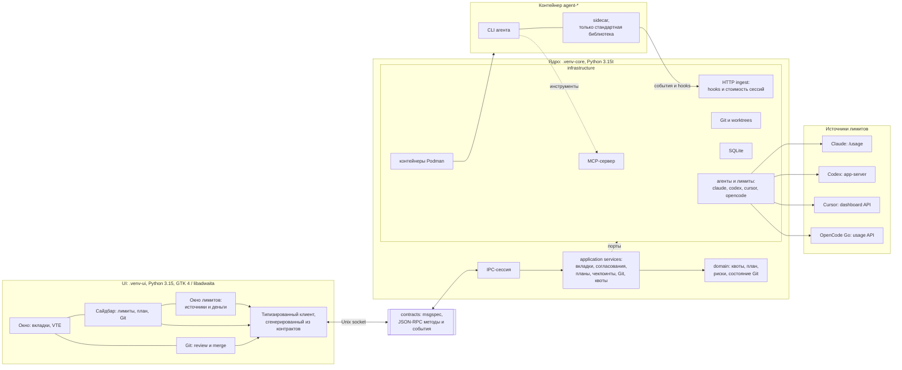

# AConsole

Версия исходников: **0.1.1 — Работа с Git**. Опубликованный релиз — **0.1.1**
(2026-11-06); предыдущий — **0.1.0**. В `main` уже есть невыпущенные исправления
для планируемой **0.1.2** — она выйдет после завершения плана `plan-1`.
[План 0.1.1](plans/0.1.1-git.md) · [история версий](CHANGELOG.md).

[](https://github.com/secachiss-code/agent_console_p/actions/workflows/check.yml)
[](https://github.com/secachiss-code/agent_console_p/releases)
[](https://github.com/secachiss-code/agent_console_p)
[](https://github.com/secachiss-code/agent_console_p)

**AConsole** — настольная консоль для работы с CLI-агентами. Она запускает Claude Code,
Codex CLI, OpenCode и Cursor CLI в контейнерах Podman, объединяет исполнителей в рабочие
сессии задач и добавляет поверх терминала то, чего обычно не хватает при работе с агентами:
согласования опасных команд, доску планов с MCP-инструментами, чекпоинты, страницу Git для
review и merge, а также панель лимитов и расходов по подпискам.

> **Статус: рабочий прототип.** Проект проверен только на Linux-машине автора. API,
> поведение и формат внутренних данных могут меняться. Это не песочница и не замена
> контейнерной изоляции: агент по-прежнему работает с правами пользователя внутри
> контейнера.

## Версии

| Версия | Статус | Главное отличие |
|---|---|---|
| **0.1.0** | опубликован 2026-11-04 | Первый `.deb`. Проект → вкладка: у каждой вкладки свой worktree и ветка. Согласования, планы/MCP, чекпоинты, Git-страница, лимиты. |
| **0.1.1** | опубликован 2026-11-06 | Проект → рабочая сессия задачи → вкладки-исполнители: общая история, эстафета, изолированные worktree, слияние результата сессии. Плюс буфер обмена и исправления безопасности/устойчивости. |
| **0.1.2** | планируется после завершения `plan-1` | Безопасность hostrun и Git, режимы согласований, честная матрица возможностей harness, надёжность сессий/статусов, UX и доступность, финальные QA-проверки. |

Подробная разница между версиями, включая уже вошедшие в `main`, но ещё не выпущенные
исправления, описана в [CHANGELOG.md](CHANGELOG.md). Версия в `pyproject.toml` и ответе
ядра остаётся `0.1.1`, пока план 0.1.2 не закрыт.

## Возможности

### Проекты, сессии задач и worktree

- Можно добавить любой Git-репозиторий; базовая ветка берётся из его `HEAD`, а не считается
  заранее равной `main`.
- Рабочая сессия (`WorkSession`) владеет основной копией, веткой и историей задачи.
  Это отдельная сущность от нативного диалога CLI (`agent_session_id`).
- Для основной копии сессии доступны три режима:
  - **новый worktree** — отдельная ветка `ac/s-<slug>-<id>` и каталог
    под `~/.local/share/aconsole/worktrees/<repo>/`;
  - **основной checkout** — работа прямо в корне проекта;
  - **существующий worktree** — уже созданный каталог.
- Несколько вкладок могут исполнять одну задачу последовательно. В общем каталоге
  запускается один агент; действие «Передать управление» останавливает прежнего,
  проверяет процессы и сохраняет снимок. Простое переключение вкладок право записи
  не передаёт. Если остановку подтвердить нельзя, запуск следующего блокируется.
- Добавление второго агента сохраняет новую вкладку даже при занятой общей копии.
  Во вкладке показывается ожидание и кнопка «Передать управление» с подтверждением.
- Для параллельной работы выберите изолированного исполнителя: он получает detached
  worktree от HEAD сессии. Его сохранённый результат принимается сначала в сессию,
  затем вся сессия сливается в базовую ветку.
- Закрытие вкладки сохраняет рабочие копии и историю. Архивирование сессии останавливает
  её агентов; сессию с сохранённой основной копией можно возобновить.
- Удаление управляемой копии выполняется отдельно после слияния и проверок Git.
  Основной checkout и импортированные worktree не удаляются. После squash исходные
  коммиты удерживаются ref. История остаётся после удаления основной копии, но такую
  сессию возобновить нельзя. Копии изолированных исполнителей очищаются отдельно.
- При очистке проверяются новые коммиты, dirty и ignored файлы. Незакоммиченные файлы
  исполнителя могут быть приняты снимком; его грязная копия при этом сохраняется.
- Для проекта показываются ahead/behind, staged/unstaged/untracked/conflicted, состояние
  merge/rebase/cherry-pick и preview слияния.

### Агенты и контейнеры

Поддерживаются четыре агента:

| Агент | Команда в контейнере | Контейнер по умолчанию |
|---|---|---|
| Claude Code | `claude` | `agent-claude` |
| Codex CLI | `codex` | `agent-codex` |
| OpenCode | `opencode` | `agent-opencode` |
| Cursor CLI | `agent` | `agent-cursor` |

AConsole **не создаёт контейнеры сама**. Она ожидает существующие контейнеры с именами
`agent-claude`, `agent-codex`, `agent-opencode` и `agent-cursor` (можно создать их через
Distrobox или Podman), при необходимости запускает остановленный контейнер и выполняет
команду через `podman exec` от имени пользователя хоста. Поэтому CLI агента, его логин,
монтирование worktree и vault должны быть настроены внутри контейнера заранее.

> **Изоляция контейнеров:** мастер и окно диагностики проверяют монтирования
> агентов и devtools. Общий HOME открывает агенту базу AConsole, секреты и файлы
> запуска хоста. Предупреждение не меняет контейнеры автоматически.
> [Рекомендуемая конфигурация и проверка](#container-isolation-sec-7).

<a id="container-isolation-sec-7"></a>
### Container isolation (SEC-7)

Рекомендуемый минимум — отдельный HOME внутри контейнера и bind-доступ только
к рабочим копиям и vault. Не монтируйте весь HOME, каталог данных AConsole,
`.config`, `.ssh`, `.aws`, файлы shell-профилей, пользовательские systemd units,
Podman/Docker sockets, hostrun socket, host-bins или `/run/host`.
Read-only HOME тоже раскрывает данные; смена HOME внутри контейнера не отменяет
доступ к прежнему HOME через другой mount. Distrobox с интеграцией хоста и
одним `--home` не является проверенной изолированной конфигурацией.

Перед изменениями остановите агентов, сохраните их сессии и настройки входа,
просмотрите `podman inspect --format '{{json .Mounts}}' agent-claude` и аналогичные
выводы остальных агентов и devtools. Новую конфигурацию создаёт пользователь;
AConsole не пересоздаёт контейнеры и не переносит секреты автоматически.

Пример **шаблона** отдельного rootless Podman-контейнера (не команда миграции):
образ `YOUR_AGENT_IMAGE` должен содержать CLI, `/bin/sh`, пользователя с именем
и UID пользователя хоста, а также рабочий HOME этого пользователя.
Замените имя контейнера, образ и пути на выбранные вами. Отдельный новый контейнер
не заменит используемый приложением `agent-claude`, пока вы явно не переключите его.

```bash
podman create --name agent-claude-isolated --userns=keep-id \
  --user "$(id -u):$(id -g)" --cap-drop=all \
  --security-opt=no-new-privileges \
  --mount "type=bind,src=$HOME/.local/share/aconsole/worktrees,dst=$HOME/.local/share/aconsole/worktrees" \
  --mount "type=bind,src=$HOME/Obsidian/AConsole,dst=$HOME/Obsidian/AConsole" \
  YOUR_AGENT_IMAGE sleep infinity
```

Если используется `XDG_DATA_HOME` или иной путь к workspace/vault, замените пути
на фактические и сохраните их одинаковыми на хосте и в контейнере. Не добавляйте
общий родительский каталог ради короткой записи. Вход CLI и его конфигурация
должны храниться в отдельном HOME; настройки host-exec не переносите.
Rootless режим, bind mounts, keep-id и no-new-privileges описаны в
[документации Podman](https://docs.podman.io/en/latest/markdown/podman-create.1.html).

После ручного запуска нового контейнера проверьте его mounts и без записи
проверьте, что агент не видит настоящие файлы хоста через их прежние пути:

```bash
podman inspect --format '{{json .Mounts}}' agent-claude-isolated
podman exec --user "$USER" agent-claude-isolated test ! -e "$HOME/.local/share/aconsole/aconsole.db"
podman exec --user "$USER" agent-claude-isolated test ! -e "$HOME/.config/systemd/user"
```

При отдельном HOME путь `$HOME/.bashrc` внутри контейнера может существовать:
это должен быть контейнерный файл, а не файл хоста. Проверяйте соответствие
Source/Destination, включая mounts из containers.conf и дополнительные пути
доступа. Не пытайтесь подтвердить изоляцию записью в настоящую базу или профили.
Проверьте также отсутствие привилегированного режима и host PID namespace.
В мастере выполните диагностику заново; в окне состояния нажмите
«Проверить монтирования контейнеров». Ошибка inspect считается неизвестной
изоляцией. Проверка mounts выявляет известные опасные пути, но не является
полным аудитом образа, привилегий, IPC и ядра ОС.

Изолированная конфигурация намеренно не предоставляет прямой host-exec и
доступ к hostrun. Для devtools нужны отдельно согласованные workspace и дисплей;
общий HOME не требуется. До независимого проверяющего из GATE-1 агентский
hostrun gate выдаёт только диагностический UNVERIFIED (SEC-4).

Что ещё умеют вкладки:

- продолжить существующую сессию там, где агент это поддерживает: Claude — `--resume`,
  Codex — `codex resume`, OpenCode — `-s <session>`; у Cursor в этой сборке resume нет;
  в диалоге новой вкладки CLI-сессия выбирается отдельно от рабочей сессии задачи.
  Claude/Codex читаются из метаданных выбранного проекта и его рабочих копий;
  для списка OpenCode нужен работающий сервер, созданный этим ядром.
  При отсутствии ID/файла сессии «Продолжить» не запускает новую беседу молча.
- форкнуть сессию через меню вкладки там, где агент это поддерживает (Claude и Codex).
  Ожидающий fork сохраняется при рестарте ядра; после сообщения нового ID вкладка
  продолжает дочернюю беседу. Пока ID исходной сессии неизвестен, fork недоступен;
- переименовать, переставить и закрыть вкладку;
- показать статус `starting`, `idle`, `working`, `waiting_approval`, `waiting_input`,
  `error`, `exited` или `unknown`. Надёжность статусов на реальных CLI и фикстурах
  OpenCode/Cursor ещё проверяется в 0.1.2 (HAR-4);
- подсветить вкладку, которой нужно внимание, и отправить уведомление.

Выбор существующей нативной сессии из списка в текущей сборке недоступен: маршрут
`session/list` пока реализован только в fake core. Исправление — HAR-3 в 0.1.2.

### Терминал и палитра

- Полноценный терминал VTE с прокруткой, изменением размера, копированием и вставкой,
  поиском по экрану и масштабированием.
- Между VTE и агентом стоит небольшой sidecar на стандартной библиотеке Python: он держит
  PTY, передаёт сигналы и умеет определять «экран затих» для агентов без hooks (OpenCode и
  Cursor).
- Командная палитра (`Ctrl+Shift+P`) ищет команды, навыки агента, узлы планов, заметки
  vault, вкладки, сессии, действия и согласования. У неё есть отдельный шаг аргумента и
  запоминание ранжирования. В текущей сборке палитра работает в демо-режиме `--fake`;
  маршруты `palette/*` и `session/list` в настоящем ядре ещё не реализованы. Подключение
  к реальному ядру — 0.1.2 (UX-3).
- Горячие клавиши можно переопределить в настройках. Основные:

| Клавиши | Действие |
|---|---|
| `Ctrl+Shift+P` | командная палитра |
| `Ctrl+Shift+T` | новая вкладка |
| `Ctrl+Shift+W` | закрыть вкладку |
| `Ctrl+Tab`, `Ctrl+PageDown` | следующая вкладка |
| `Ctrl+Shift+Tab`, `Ctrl+PageUp` | предыдущая вкладка |
| `Alt+1…9` | перейти к вкладке по номеру |
| `Ctrl+Shift+Y` | следующая вкладка, требующая внимания |
| `Ctrl+Shift+Enter` | разрешить согласование |
| `Ctrl+Shift+Backspace` | отклонить согласование |
| `Ctrl+Shift+D` | diff |
| `Ctrl+Shift+G` | страница Git |
| `Ctrl+Shift+F` | поиск в терминале |
| `Ctrl+Shift+C` / `Ctrl+Shift+V` | копировать / вставить |
| `F9`, `Ctrl+Shift+B` | показать или скрыть сайдбар |
| `Ctrl+,` | настройки |
| `Ctrl+?`, `F1` | список горячих клавиш |
| `Ctrl+=`, `Ctrl+Alt+-`, `Ctrl+0` | крупнее, мельче, обычный текст терминала |
| `Ctrl+Q` | выход |

### Согласования

- Claude Code и Codex могут присылать запрос на опасный инструмент. Для Codex AConsole
  сначала проверяет определения и доверие hooks через установленный CLI. После успешной
  проверки запрос показывается карточкой поверх терминала этой вкладки: команда,
  рабочий каталог, риск и срок действия. Кнопки решения остаются видимыми, детали
  прокручиваются отдельно.
- Если окно или вкладка не в фокусе, приходит системное уведомление; клик открывает
  вкладку с запросом. На один эпизод создаётся одно уведомление, при решении оно
  отзывается.
- Решение можно принять один раз или запомнить для текущей сессии вкладки. Отказ можно
  сопроводить сообщением агенту. Разовый `ALLOW` не разрешает независимый повторный
  вызов с теми же входными данными.
- Запрос можно вернуть агенту в его нативный prompt, если вы хотите решить его в терминале.
- У запроса есть nonce, срок жизни и дедупликация по входным данным; повторная доставка
  того же события не создаёт вторую карточку.
- Команды классифицируются по рискам: `destructive`, `outside_worktree`, `network`,
  `publish`, `secrets`, `privilege`. Команды, которые разбор не понял, считаются
  рискованными.
- Запомненное разрешение по префиксу — не «любая команда с этим началом». Оно работает
  только для программ и подкоманд из встроенного allowlist, только для «простых» слов без
  раскрытия shell и только пока пути остаются внутри worktree. Всё остальное требует
  точного совпадения.
- Для `Write`, `Edit` и MCP-вызовов в текущей сборке показываются не все детали: путь,
  diff и аргументы инструмента ещё не выводятся полностью. Полный просмотр и пометка
  рискованных путей — 0.1.2 (APR-2).
- Сейчас настраивается только место вопроса (`inline` или `native`) и разовые/сессионные
  решения. Режимы «спрашивать», «разрешать» и «запрещать», их подрежимы и уровни
  «глобально/проект» появятся в 0.1.2 (APR-4…APR-9).
- OpenCode и Cursor не имеют hooks для inline-согласований, поэтому их запросы остаются
  нативными запросами в терминале. Честная матрица возможностей и перехват для этих
  harness'ов — 0.1.2 (APR-6…APR-8).

Согласования — это дополнительный барьер, а не замена изоляции контейнера. Агент всё равно
может изменить любой файл, доступный ему в смонтированном worktree.

### Планы, MCP и база знаний

Ядро AConsole поднимает MCP-сервер на loopback-адресе. Каждая вкладка получает свой
bearer-токен, поэтому инструменты работают в контексте конкретного проекта, worktree и
агента. Агент видит двенадцать инструментов:

| Инструмент | Назначение |
|---|---|
| `plan_create` | создать план; повтор с тем же названием возвращает тот же план |
| `plan_add_nodes` | добавить узлы; существующие ключи не меняются, цикл не добавляется |
| `plan_get` | прочитать план; `response_format=detailed` и `since=<revision>` дают детали или только изменения |
| `plan_ready` | список узлов, которые можно взять в работу, по приоритету |
| `node_claim` | взять lease узла и получить fence для последующих вызовов |
| `node_update` | сменить статус, отправить heartbeat, заметку или evidence |
| `node_attach` | прикрепить commit, file, test_report, url или note |
| `ctx_get` | получить знания по узлу или запросу |
| `kb_add` | записать факт, решение или требование; источник факта должен существовать |
| `kb_impact` | посмотреть, что зависит от цели, по графу кода |
| `handover` | записать или прочитать handover по текущей работе |
| `plan_list` | список планов проекта |

План — это DAG: у узлов есть ключи, зависимости, родитель, связанные узлы, владелец,
пути, критерии приёмки, тестовая команда, флаг review и границы работы. Статусы:
`pending`, `in_progress`, `verifying`, `blocked`, `done`, `failed`, `cancelled`. Узлы
берутся через lease с fence, поэтому два агента не должны незаметно работать над одним
узлом.

Ответы MCP-инструментов сжаты: без отступов, пустых полей и лишних схем. AConsole также
считает, сколько байт ответов инструментов попало в контекст агента, и показывает это в
интерфейсе.

Планы синхронизируются с Obsidian-vault:

- по умолчанию vault — `~/Obsidian/AConsole`;
- узлы плана лежат в `plans/<plan>/<KEY>.md` с YAML frontmatter;
- тело заметки под frontmatter после первой записи принадлежит пользователю;
- при редактировании frontmatter выполняется трёхсторонний merge: принятые поля
  возвращаются на доску планов, отклонённые записываются обратно так, как их видит ядро;
- заметки `facts/<project>-to-review.md` перечисляют факты, код вокруг которых изменился
  после проверки;
- `.obsidian/` не считается источником истины, а ссылки, выходящие за пределы vault, не
  разрешаются.

### Чекпоинты

- Для Claude Code перед каждым пользовательским промптом снимается чекпоинт worktree.
  Для Codex автоматические чекпоинты включаются после успешной проверки hooks.
- История сессии хранит начало этапа, передачу управления, результат и защитные снимки
  на `refs/aconsole/sessions/<sid>/checkpoints/<seq>`. Старые чекпоинты и ссылки
  `refs/aconsole/checkpoints/<tab>/<n>` сохраняются при миграции.
  Снимок не изменяет `HEAD` или индекс пользователя.
  Для снимка используется приватный индекс; `git stash` и `git reset --hard` не
  применяются.
- Список чекпоинтов показывает номер, время, label, число файлов и вставок/удалений.
- Перед восстановлением показывается preview с diffstat и списком файлов; восстановление
  требует одноразовый confirm-токен.
- Перед восстановлением создаётся safety-чекпоинт текущего состояния. Восстановление
  затрагивает отслеживаемые и новые файлы worktree, но не игнорируемые (`.gitignore`).
- Восстановление файлов через историю сессии сначала останавливает её исполнителей
  и сохраняет защитный снимок. HEAD и обычный индекс остаются прежними.
- История сессий не очищается автоматически. Ограничение 5–500 (по умолчанию 100)
  относится к прежнему списку чекпоинтов вкладки.
- OpenCode и Cursor участвуют в снимках жизненного цикла сессии; автоматических
  снимков перед каждым промптом у них нет, поскольку отсутствуют hooks.

### Git

Страница Git — это не просто `git status`:

- проектный обзор и выбор сессии, её участники и история этапов;
- состояние worktree и веток, ahead/behind, staged/unstaged/untracked/conflicted;
- граф коммитов и чекпоинтов, включая привязку к плану, агенту и вкладке;
- diff по файлам и хункам, stage/unstage, commit;
- восстановление отдельного файла из коммита с preview и confirm-токеном;
- preview слияния через `git merge-tree` и режимы fast-forward, merge и squash;
- rebase, cherry-pick, continue/abort незавершённой операции;
- удаление worktree с отдельным подтверждением для игнорируемых файлов;
- отправка diff другому агенту во вкладку (с preview и подтверждением);
- список фактов, которые стоит перепроверить после изменений кода.

Коммиты, сделанные через AConsole, получают `AConsole-Session` и доступные trailers
узла, агента и вкладки. Для нескольких исполнителей финальное слияние сохраняет список
участников и узлов, не назначая последнего агента автором всей задачи. Коммиты внешнего
CLI допустимы без trailers; точное авторство строк приложение не выводит из Git.
Слияние проверяет, что source/target не изменились с момента preview; устаревший preview
не применяется.

### Лимиты и расходы

Сайдбар показывает лимиты по каждому подключённому аккаунту. Окно лимитов умеет
обновляться вручную и объясняет, откуда взято число и когда оно наблюдалось.

| Агент | Окна | Деньги |
|---|---|---|
| Claude | 5 часов, неделя | extra usage, стоимость сессии |
| Codex | 5 часов, неделя, spend limit | баланс кредитов или unlimited |
| Cursor | месяц, в процентах | on-demand pool |
| OpenCode | 5 часов, неделя, месяц | стоимость сессии |

Источники:

- Claude — `/usage` внутри контейнера;
- Codex — `account/rateLimits/read` через `codex app-server`;
- Cursor — dashboard API Cursor;
- OpenCode Go — usage API OpenCode.

Для Cursor и OpenCode используются те же endpoint'ы, что и в их dashboard. Это не
публичные API, их формат может измениться. Порог предупреждения по умолчанию — 80%,
критический — 95%; отображение можно переключить между «использовано» и «осталось».
Токены по моделям Claude и Codex читаются из их локальных session-логов; AConsole хранит
только числа и имена моделей, не содержимое переписки.

### Настройки и проверка окружения

В настройках можно изменить:

- путь к Obsidian-vault и каталогу worktree;
- режим согласований (`inline` или `native`) и время удержания запроса (30–540 секунд);
- уведомления (`unfocused`, `always`, `never`);
- шрифт и размер терминала, scrollback (1 000–200 000 строк);
- тему (`system`, `light`, `dark`);
- пороги квот и отображение used/remaining;
- включение чекпоинтов и их количество;
- переопределения горячих клавиш;
- языки codegraph;
- флаг завершённой настройки.

Мастер первого запуска проверяет:

- `podman` и `distrobox`;
- контейнеры `agent-*`;
- версии CLI и статус логина (Claude проверяется автоматически; для остальных агентов
  результат может требовать ручной проверки);
- каталог vault;
- монтирование worktree и vault в контейнеры;
- инструменты `devtools` (Python, Cargo, .NET, Node);
- `notify-send` и сессионный D-Bus.

Для исправлений показывается preview и требуются явные подтверждение и повторная проверка.
Есть диалог здоровья ядра (очередь записи в БД, ошибки writer, latency IPC, resync).
Подтверждение перед выходом при занятых вкладках или ожидающих согласованиях пока не
реализовано: окно закрывается сразу, а ядро останавливается уже после скрытия окна.
Исправление — 0.1.2 (UX-2).

## Как это устроено



### Два процесса на двух Python

Ядро требует free-threaded Python (3.15t), а GTK не загружается под ним. Поэтому AConsole
запускает два процесса:

- **UI** — `.venv-ui`, Python 3.15 с GIL, GTK 4, libadwaita и VTE;
- **ядро** — `.venv-core`, Python 3.15t, без GTK.

Они не делят память и общаются только через JSON-RPC по Unix-сокету
`$XDG_RUNTIME_DIR/aconsole/core.sock` (или `~/.local/state/aconsole/core.sock`, если
`XDG_RUNTIME_DIR` не задан). Ядро держит эксклюзивную блокировку, поднимается по требованию
и завершается после простоя; UI может подключиться к уже запущенному ядру.

### Контракты и слои

`src/aconsole/contracts` — единственное, что разделяют UI и ядро. Контракты описаны на
msgspec; из них генерируются типизированный клиент, JSON Schema и OpenAPI для ingest.
Поэтому UI и ядро не могут разойтись в названиях методов и полей незаметно.

Правила слоёв проверяются import-linter:

- UI не импортирует core;
- core не импортирует UI и `gi`;
- domain не импортирует SQLAlchemy, msgspec, MCP, uvicorn, watchdog и subprocess;
- application не импортирует infrastructure;
- contracts не импортирует остальной AConsole;
- sidecar остаётся на стандартной библиотеке.

### Ядро

- **domain** — чистые правила: квоты, план, риски команд, approvals, checkpoints,
  состояние Git, vault sync.
- **application** — сценарии и порты: вкладки, проекты, согласования, чекпоинты, Git,
  review, квоты, setup.
- **infrastructure** — адаптеры: Podman, Git, SQLite, HTTP ingest, MCP, vault, codegraph,
  агенты и их лимиты, fake core для демо.

SQLite хранит проекты, вкладки, настройки, планы, знания, approvals, чекпоинты и
журналы Git-операций; схема поднимается через Alembic. Запись идёт через очередь writer,
а здоровье очереди видно в диалоге здоровья.

HTTP ingest слушает только `127.0.0.1`; у каждой вкладки свой bearer-токен, проверяется
Origin, тело ограничено 1 MiB, очередь событий ограничена и при переполнении сохраняет
последнее состояние вкладки. MCP-сервер живёт на `/mcp` рядом с ingest и использует те же
токены вкладок.

### Sidecar и hooks

Sidecar запускается как `python -m aconsole.sidecar -- <команда агента>` внутри контейнера.
Он:

- создаёт PTY и соединяет его с VTE;
- передаёт `SIGWINCH`, `SIGTERM` и `SIGHUP`;
- отправляет в ядро `started`, `exited`, `stats` и сигналы экрана по NDJSON;
- для Cursor и OpenCode определяет, что терминал затих, и отдаёт последние строки ядра;
- не импортирует контракты, `gi`, `mcp`, `msgspec`, SQLAlchemy или uvicorn — только
  стандартную библиотеку.

Claude и Codex запускаются с настройками интеграции с локальным ingest. Перед запуском
Codex AConsole дважды обращается к `codex app-server`: получает `hooks/list`, сверяет
семь собственных command-hooks и добавляет их индивидуальные хэши в `hooks.state`,
затем проверяет статус `trusted`. Постоянный `~/.codex/config.toml` не изменяется,
пользовательские и проектные hooks не получают доверия от AConsole.

До успешной проверки Codex не заявляет возможности `hooks`, `approvals` и `checkpoints`.
Если CLI не ответил или определения не совпали, Codex запускается с MCP и notify без
hooks AConsole. Уведомление объясняет: откройте `/hooks` в Codex, проверьте настройки
hooks и ограничения администратора, затем перезапустите агента в AConsole.
Согласования в этом случае остаются в терминале, автоматические чекпоинты отключены.

### Демо без агентов

Встроенный fake core позволяет посмотреть интерфейс без Podman и контейнеров:

```sh
.venv-ui/bin/aconsole --fake demo
```

Доступны сценарии `demo`, `empty`, `stress`, `errors`, `waiting`, `quota-critical`,
`approval-expired` и `agents`.

## Планируется в 0.1.2

0.1.2 — следующая версия после завершения `plan-1`. Она не выпущена; версия в
`pyproject.toml` пока остаётся `0.1.1`. Основные направления:

- **Безопасность.** Закрыть оставшиеся host-exec действия hostrun, подделку review gate
  и self-approval; проверить доступ агента к базе AConsole и домашнему каталогу хоста,
  дать мастеру и health предупреждение с рекомендуемой конфигурацией монтирования;
  закрыть оставшуюся гонку динамических Git-драйверов и проверить все вызовы Git вне
  runner (SEC-1, SEC-3, SEC-4, SEC-7, SEC-11).
- **Согласования.** Показывать пути и diff для Write/Edit, инструмент и аргументы для MCP,
  длинные команды целиком; добавить режимы «спрашивать / разрешать / запрещать» с
  подрежимами и уровнями глобально/проект, адаптеры Claude, OpenCode, Codex и Cursor,
  честную матрицу применимости (APR-2, APR-4…APR-9).
- **Harness.** Исправить форк и выбор нативной сессии, resume там, где он поддержан;
  сделать статусы вкладок устойчивыми на реальных CLI; укрепить sidecar и наблюдатели
  (HAR-3…HAR-5).
- **UX и доступность.** Подтверждение закрытия окна и вкладки при работающем агенте,
  палитра на настоящем ядре, режимы новой вкладки и управление проектами, понятные
  ошибки первого запуска, локализация и различимость состояний (UX-2, UX-3, UX-5, UX-6;
  FE-1, DES-2…DES-4).
- **Ядро и данные.** Убрать блокировки из общего потока и event loop, исправить lease MCP,
  устойчивость IPC и очереди ingest; завершить приёмку GIT-1…GIT-4 и REL-4, закрыть
  оставшиеся проверки сохранности данных (CORE-2, CORE-4, CORE-5; REL-3, AUD-2).
- **QA и выпуск.** Закрыть проверки на настоящем ядре, CI/сборку/контракты, гигиену
  репозитория и лицензию; провести финальную проверку согласований и выпуска
  (QA-1…QA-6, CMT-1, CMT-2).

В `main` после 0.1.1 уже вошли: GIT-1…GIT-4 (неизменяемый результат WorkSession,
грязные submodules, безопасная очистка ignored-файлов), SEC-5 (изоляция approval по
вкладкам), SEC-10 (токены не в argv, проверка session id, Origin/Host для MCP),
CORE-6/CORE-7 (retention, WAL, повтор failed-узла), REL-4 (отказ старому ядру без
`work_sessions.v1`), PERF-3/PERF-4, AUD-1 и PLAN-3. Эти изменения не входят в локальный
пакет 0.1.1.

Состояние `plan-1` на 2026-11-07: 17 узлов `done`, 52 `pending`, 4 `blocked`, 2 `failed`.
`PLAN-2` остаётся красным до успешного полного GTK/UI-прогона, `PERF-2` — до устранения
превышения задержки writer tick. `AUD-2`, `QA-3`, `QA-4` и `QA-5` заблокированы
внешними условиями (живое окно/CLI, CI, лицензия). Часть открытых узлов уже имеет
коммиты, но ещё не принята и не закрыта в плане. Полный граф и состояние на момент
снимка: [отчёт PLAN-2](artifacts/plan-refresh-2026-11-06/REPORT.md).

Критерий выпуска 0.1.2: план закрыт или явно переведён в accepted/waived, полные
core/GUI/package-проверки зелёные, проведены проверки на настоящих CLI и окне,
версия поднята до 0.1.2, пакет собран и опубликован.

## Требования

| Что | Требование |
|---|---|
| ОС | Linux с X11 или Wayland; проект проверялся только на машине автора |
| GTK | GTK 4.14+, libadwaita 1.5+, VTE 3.91 и их GObject introspection |
| Git | обычный Git; worktree и side refs используются активно |
| Контейнеры | Podman; контейнеры `agent-claude`, `agent-codex`, `agent-opencode`, `agent-cursor` |
| Distrobox | рекомендуется для создания контейнеров и PATH; AConsole не запускает `distrobox assemble` |
| Агенты | CLI установлен и залогинен внутри своего контейнера |
| Python | для запуска из исходников — `uv` и Python 3.15t + 3.15; в `.deb` Python уже внутри |
| Уведомления | `notify-send` и сессионный D-Bus — опционально |
| Codegraph | Python, Cargo, .NET и Node в контейнере `devtools` — опционально |

Пакет `.deb` зависит от `git`, `podman`, `gir1.2-gtk-4.0 (>= 4.14)`,
`gir1.2-adw-1 (>= 1.5)`, `gir1.2-vte-3.91`, `libgirepository-2.0-0`, `libcairo2`,
`libcairo-gobject2` и `libffi8`. Сами CLI агентов в пакет не входят.

## Установка

### Из GitHub Release (.deb)

Ниже — ссылки на опубликованный **0.1.1**. Предыдущий релиз **0.1.0** остаётся
доступен на [своей странице](https://github.com/secachiss-code/agent_console_p/releases/tag/v0.1.0).
Сборка создаётся командой `.venv-core/bin/python packaging/build_deb.py` в `dist/`.
Опубликованный пакет: `dist/aconsole_0.1.1_amd64.deb`, 67 586 408 байт, SHA-256
`23b001936f03cc2f15c9ffdcc6fbc0b68235d212b817eea8e8bf44a2ded2de16`; файлы
`src/aconsole` и `migrations` в нём побайтово соответствуют коммиту `45152a1`.
**0.1.2** пока планируется: её пакет будет собран и опубликован после завершения
`plan-1`. Готовый пакет для `amd64` лежит в GitHub Releases, а не в Git-репозитории:
бинарные артефакты не стоит коммитить в историю.

- Страница релиза: <https://github.com/secachiss-code/agent_console_p/releases/tag/v0.1.1>
- Прямая ссылка:
  <https://github.com/secachiss-code/agent_console_p/releases/download/v0.1.1/aconsole_0.1.1_amd64.deb>
- Контрольные суммы:
  <https://github.com/secachiss-code/agent_console_p/releases/download/v0.1.1/SHA256SUMS>

```sh
wget https://github.com/secachiss-code/agent_console_p/releases/download/v0.1.1/aconsole_0.1.1_amd64.deb
sha256sum aconsole_0.1.1_amd64.deb
# 23b001936f03cc2f15c9ffdcc6fbc0b68235d212b817eea8e8bf44a2ded2de16

sudo apt install ./aconsole_0.1.1_amd64.deb
aconsole
```

Пакет ставит:

- `/usr/bin/aconsole` — UI;
- `/usr/bin/aconsoled` — ядро;
- собственные Python 3.15t и 3.15 под `/opt/aconsole`;
- `.desktop`-файл и иконки.

Системными остаются GTK, libadwaita, VTE, Git, Podman и драйверы. Пакет собран для
Debian/Ubuntu на `amd64`; для других архитектур и дистрибутивов нужна отдельная сборка.
Пакет не подписан GPG — сверяйте SHA256.

Данные пользователя по умолчанию лежат в `~/.local/share/aconsole` (или в
`$XDG_DATA_HOME/aconsole`); установка и удаление пакета их не удаляют. Для удаления:

```sh
sudo apt remove aconsole
```

### Из исходников

Нужны GTK-зависимости, Git, Podman и `uv`. Пример для Debian/Ubuntu:

```sh
sudo apt install gir1.2-gtk-4.0 gir1.2-adw-1 gir1.2-vte-3.91 \
  libgirepository-2.0-dev libcairo2-dev git podman
```

Установите оба Python и соберите окружения:

```sh
uv python install 3.15t 3.15
./install.sh
.venv-ui/bin/aconsole
```

`install.sh`:

- синхронизирует `.venv-core` и `.venv-ui` из `uv.lock`;
- проверяет, что core действительно free-threaded, а UI — с GIL;
- добавляет ярлык и иконки в `~/.local/share/applications` и `~/.local/share/icons`;
- не устанавливает системные пакеты и не повышает привилегии.

Если checkout находится вне `$HOME`, нужен флаг `--allow-outside-home`. Посмотреть, что
будет сделано, можно через `./install.sh --dry-run`.

Запуск без установки ярлыка:

```sh
.venv-ui/bin/aconsole
```

Демо-режим без Podman:

```sh
.venv-ui/bin/aconsole --fake demo
```

Ядро можно запустить отдельно:

```sh
.venv-core/bin/aconsoled --serve
```

Но обычно UI сам поднимает его через Unix-сокет.

## Первый запуск

1. **Проверьте окружение.** Мастер настройки покажет результаты проверок и предложит
   исправимые действия. Если контейнеров `agent-*` нет, их нужно создать.
2. **Подготовьте контейнеры.** AConsole не создаёт их. Имена по умолчанию:
   `agent-claude`, `agent-codex`, `agent-opencode`, `agent-cursor`. В каждом должен быть
   установлен и залогинен соответствующий CLI. Каталог worktree и vault должен быть
   смонтирован в контейнер по тому же пути, что и на хосте.
3. **Добавьте проект.** Укажите корень Git-репозитория. AConsole возьмёт базовую ветку из
   `HEAD` и покажет проект в сайдбаре.
4. **Создайте вкладку.** Выберите новую задачу или существующую рабочую сессию, агента
   и общий либо изолированный режим. Для новой задачи задайте основной workspace
   и базовую ветку; при необходимости укажите узел плана или нативный диалог CLI.
5. **Работайте.** Агент живёт в терминале; согласования, план, чекпоинты, Git и лимиты
   доступны в сайдбаре и на отдельных страницах.
6. **Завершите задачу.** Проверьте Git, примите результаты исполнителей, закоммитьте
   основную копию и слейте сессию в базу. Архивирование сохраняет копии; удаление
   управляемой основной копии выбирается отдельно. Закрытие вкладки задачу не удаляет.

Если что-то не работает:

- `agent-* container not found` — создайте контейнер или проверьте имя;
- агент не залогинен — залогиньтесь в его CLI внутри контейнера;
- нет лимитов — проверьте логин и обновите окно лимитов; endpoint'ы Cursor и OpenCode
  могут меняться;
- нет уведомлений — установите `notify-send` и проверьте `DBUS_SESSION_BUS_ADDRESS`;
- `AF_UNIX path too long` в тестах — передайте короткий `--basetemp`;
- ядро отказывается стартовать с сообщением про GIL — вы запустили его не тем Python;
  используйте `.venv-core` (free-threaded) для ядра и `.venv-ui` для UI.

## Типичный цикл работы

1. Добавьте проект и создайте вкладку с новым worktree.
2. Сформулируйте задачу агенту в терминале.
3. Следите за статусом: `working`, `waiting_approval`, `waiting_input`.
4. Разрешайте или отклоняйте опасные команды; при необходимости запоминайте префикс.
5. Если агент использует MCP, смотрите план в сайдбаре: узлы, зависимости и прогресс.
6. Перед рискованным изменением вернитесь к чекпоинту или создайте новый.
7. Откройте diff, проверьте изменения, сделайте commit.
8. Слейте ветку в базовую через preview и выбранный режим.
9. Проверьте лимиты и стоимость сессии, чтобы не упереться в квоту.

## Проверки и тесты

Линтеры, типы, слои и контракты:

```sh
tools/check.sh
```

Он запускает `ruff`, `basedpyright` в режиме `all`, `import-linter`, проверки на отсутствие
JS и raw SQL, контрастность, соответствие контрактам и API floor.

Тесты ядра и контрактов:

```sh
.venv-core/bin/python -m pytest tests/core tests/contracts tests/unit tests/gate \
  tests/hostrun tests/smoke tests/test_package.py tests/test_contrast.py
```

Тесты интерфейса:

```sh
xvfb-run -a .venv-ui/bin/python -m pytest tests/gui tests/ui tests/smoke
```

`tests/unit` и тест прокрутки в `tests/gui/front/test_git_scale_ui.py` содержат лимиты
времени, измеренные на одной 8-ядерной машине, поэтому CI их не запускает. В CI также
исключён `test_scrolling_a_long_history`.

Если тесты падают с `AF_UNIX path too long`, передайте короткий `--basetemp`:

```sh
.venv-core/bin/python -m pytest ... --basetemp=/tmp/ac-core
```

Планы и документы API лежат в отдельном репозитории и подключаются как `docs/`. Без него
проверки, сверяющие код с документами, пропускаются и сообщают об этом.

Для замеров есть отдельные инструменты: `tools/git_bench.py`, `tools/git_snapshot.py`,
`tools/mcp_bench.py` и `tools/ui_rss.py`.

## Структура репозитория

| Путь | Что там |
|---|---|
| `src/aconsole/contracts` | JSON-RPC-контракты, схемы и генерация клиента |
| `src/aconsole/core/domain` | чистые правила: квоты, план, риски, Git, approvals, checkpoints |
| `src/aconsole/core/application` | сценарии и порты: вкладки, проекты, Git, review, квоты, setup |
| `src/aconsole/core/infrastructure` | Podman, Git, SQLite, HTTP ingest, MCP, vault, codegraph, агенты, fake core |
| `src/aconsole/ui` | GTK-интерфейс: views, viewmodels, logic, client |
| `src/aconsole/sidecar` | PTY-помощник на стандартной библиотеке |
| `src/aconsole/devcli` | CLI-клиент и проверка соответствия MCP |
| `migrations` | миграции Alembic |
| `packaging` | `.desktop`, иконки и `build_deb.py` |
| `contracts/schema` | сгенерированные JSON Schema и OpenAPI для ingest |
| `tools` | проверки, gate, hostrun, бенчмарки |
| `tests` | core, contracts, gui, ui, smoke, gate, hostrun, unit |
| `plans` | планы версий; `0.1.1-git.md` — контекст 0.1.1 |
| `artifacts` | отчёты, снимки и результаты проверок по версиям |
| `spikes` | исследовательские прототипы |
| `stubs` | заглушки типов |
| `.github/workflows/check.yml` | CI на Ubuntu 24.04 |
| `install.sh` | сборка двух окружений и ярлык |
| `pyproject.toml` | зависимости, правила слоёв и проверок |
| `dist/` | локальная сборка `.deb`; в Git не коммитится |

## Ограничения

- Это прототип, а не готовый продукт с обещанием стабильного API.
- Поддерживается Linux; Windows и macOS не тестировались.
- **Опубликованы 0.1.0 и 0.1.1.** 0.1.2 пока не выпущена. Не смешивайте версию из
  GitHub Releases с текущим деревом `main`, где уже есть невыпущенные исправления.
- AConsole не управляет созданием контейнеров и не устанавливает CLI агентов. Если в
  контейнер смонтированы домашний каталог, база AConsole или файлы запуска хоста, агент
  может их изменить; проверка монтирования — SEC-7 в 0.1.2.
- У OpenCode и Cursor нет hooks, поэтому inline-согласования и чекпоинты работают не для
  всех агентов; их статус определяется по экрану. Надёжность этих статусов и честная
  матрица возможностей — HAR-4/APR-6…APR-8 в 0.1.2.
- В текущей сборке палитра подключена к fake core; на настоящем ядре `palette/*` и
  `session/list` ещё не маршрутизируются (UX-3, HAR-3). Форк-копия продолжает
  исходную нативную сессию; выбор существующей сессии недоступен до HAR-3.
- Запросы Write/Edit/MCP показывают не все детали, длинные команды могут обрезаться;
  режимы «разрешать/запрещать» и уровни глобально/проект ещё не реализованы
  (APR-2, APR-4…APR-9).
- Подтверждение перед закрытием окна или вкладки с работающим агентом пока отсутствует:
  окно закрывается сразу (UX-2 в 0.1.2).
- Cursor и OpenCode отдают лимиты через непубличные endpoint'ы; формат может сломаться.
- Однопользовательский режим: нет серверного/multi-user развёртывания.
- Scope файлов не изолирует параллельную запись. Для неё нужны отдельные worktree.
  Внешние редакторы не блокируются; авторство их изменений может быть неизвестно.
- Выборочная отмена вклада агента и автоматический запуск цепочек по DAG не входят ни в
  0.1.1, ни в заявленный объём 0.1.2.
- `PLAN-2` (полный GTK/UI-прогон) и `PERF-2` (задержка writer tick) остаются
  незакрытыми; `AUD-2`, `QA-3`, `QA-4` и `QA-5` заблокированы внешними условиями.
  Проверки на настоящем окне и всех четырёх CLI остаются отдельной ручной приёмкой.
- Пакет собран только для `amd64` и не подписан GPG.
- В репозитории нет файла `LICENSE`; условия распространения нужно определить отдельно
  (QA-5).
- Согласования и allowlist — это защитные барьеры, а не песочница. Не давайте агенту
  доступ к тому, что не готовы потерять.

## Ссылки

- Репозиторий: <https://github.com/secachiss-code/agent_console_p>
- Релизы: <https://github.com/secachiss-code/agent_console_p/releases>
- CI: <https://github.com/secachiss-code/agent_console_p/actions/workflows/check.yml>
- Issues: <https://github.com/secachiss-code/agent_console_p/issues>
- История версий: [CHANGELOG.md](CHANGELOG.md)
