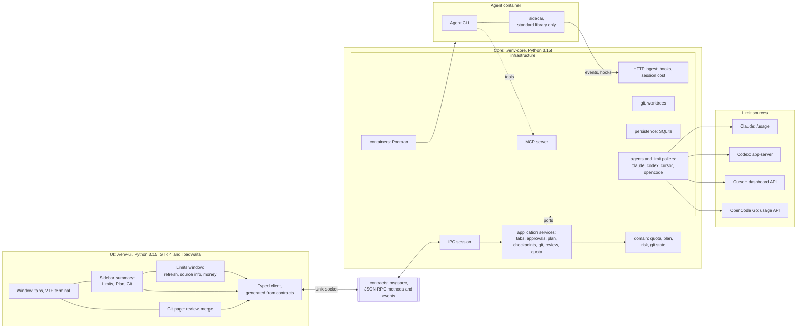

# AConsole

A desktop console for working with coding agents. It runs Claude, Codex, OpenCode and Cursor CLI in containers, one tab per
agent and worktree, and adds approvals, plans, checkpoints, and a Git page for reviewing and merging what
they did.

This is a working prototype. It has only been run on the author's Linux machine.

## What it does

- **Tabs.** Each tab is one agent in its own Podman container and Git worktree, with a VTE terminal. The **+** button
  in the header opens a new one.
- **Approvals.** Risky tool calls wait for your answer. Commands you trust can be allowed by prefix.
- **Plan and checkpoints.** The agent's plan is shown step by step. Checkpoints let you roll a worktree back.
- **Git page.** Review the diff, then commit, rebase and merge what the agent did.
- **Limits.** The sidebar summary has foldable Limits, Plan and Git sections. Limits shows each subscription's
  windows. The limits window has a refresh button and an **i** popover that says where each number came from and
  when. It also shows money: extra usage, credits, on-demand pools, and the API cost of open sessions.

| Agent | Windows | Money |
|---|---|---|
| Claude | 5 hours, week | Extra usage spent of its cap; session cost |
| Codex | 5 hours, week, spend limit | Credit balance or unlimited |
| Cursor | Month, in percent | On-demand pool spent of its cap |
| OpenCode | 5 hours, week, month | Session cost |

The Cursor and OpenCode numbers come from the same endpoints their dashboards use. Those are not public APIs, and
their format may change.

## How it fits together

The core and the UI are separate processes on different Python builds. They share nothing but the JSON-RPC contracts
in `src/aconsole/contracts`, sent over a Unix socket. Import rules in `pyproject.toml` keep the layers apart.



## Requirements

- Linux with GTK 4 and libadwaita 1.5 or newer, VTE 3.91, and their GObject introspection data
- [uv](https://docs.astral.sh/uv/), with Python 3.15 installed in both builds:
  `uv python install 3.15t 3.15`
- Git
- Podman, to run agents. The interface starts without it, but tabs cannot run.

The core needs free-threaded Python and GTK cannot load under it, so there are two environments:
`.venv-core` (3.15t) and `.venv-ui` (3.15 with the GIL). They talk over a Unix socket.

## Install and run

```sh
./install.sh            # builds both environments from uv.lock, adds a launcher to the menu
.venv-ui/bin/aconsole
```

To look around without agents or Podman, use a built-in demo scenario:

```sh
.venv-ui/bin/aconsole --fake demo
```

## Package

`./install.sh` runs from the checkout. To install apart from it on a Debian or Ubuntu system, build a package from the
two environments it made. Nothing is downloaded, and the package carries its own Python under `/opt/aconsole`:

```sh
python3 packaging/build_deb.py          # writes dist/aconsole_<version>_amd64.deb
sudo apt install ./dist/aconsole_*.deb
```

Tabs, projects and settings stay in `~/.local/share/aconsole`, shared with a run from the checkout.

## Checks

```sh
tools/check.sh                                  # lint, types, layer rules, contracts
.venv-core/bin/python -m pytest tests/core tests/contracts tests/unit tests/gate tests/hostrun tests/smoke \
  tests/test_package.py tests/test_contrast.py
xvfb-run -a .venv-ui/bin/python -m pytest tests/gui tests/ui tests/smoke
```

`tests/unit` and the scrolling test in `tests/gui/front/test_git_scale_ui.py` hold time limits measured on
one 8-core machine, so CI leaves them out.

Sockets need a short path. If tests fail with `AF_UNIX path too long`, pass a short `--basetemp`.

Plans and API documents live in a separate repository, linked in as `docs/`. Without the link, the checks
that compare code against those documents are skipped and say so.

## Layout

| Path | What it holds |
|---|---|
| `src/aconsole/contracts` | The JSON-RPC protocol: the only thing core and UI share |
| `src/aconsole/core` | Domain, application services, and infrastructure (Git, containers, SQLite, MCP) |
| `src/aconsole/ui` | The GTK interface and a client generated from the contracts |
| `src/aconsole/sidecar` | The standard-library helper that runs next to an agent |
| `tools` | Checks, the agent gate, and measuring tools such as `git_bench.py` and `git_snapshot.py` |
