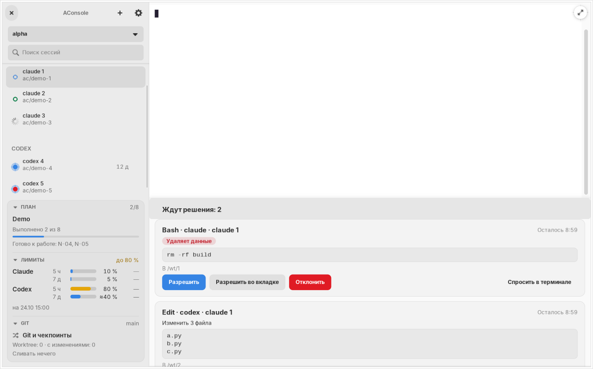

# Копирование и вставка: выполненные изменения и сборка

Дата: 2026-11-05 UTC. Коммит исходников: `a23df0e`.

## Причина ошибки

В журнале Codex обнаружено `failed to paste image: no image on clipboard`. Ctrl+V с изображением попадал в CLI внутри контейнера, где нет буфера рабочего стола. Дополнительно глобальный обработчик поглощал Ctrl+Shift+C/V, не передавая их терминалу.

## Реализация

Буфер читается асинхронно через GDK в UI. Обычная вставка предпочитает текст; действие «Вставить изображение» выбирает изображение даже при наличии текста. Текст передаётся через `Vte.Terminal.paste_text`, включая Unicode и завершающие переводы строк. Enter не отправляется.

PNG передаётся типизированным UI-only методом `terminal/prepareImagePaste`. Ядро проверяет размер, сигнатуру, CRC и границы PNG-чанков, размеры изображения; сохраняет уникальный файл в `<worktree>/.aconsole/clipboard/`. Папка имеет режим 0700, файл — 0600. Символические ссылки в папках вложений запрещены. Папка исключается локально через Git info/exclude. Перед ответом проверяется чтение файла из контейнера под пользователем агента; при отказе новый файл удаляется. Успешные вложения сохраняются вместе с рабочей копией.

Маршрут не зависит от вида агента. Он покрыт параметризованными проверками контрактного перечисления агентов, включая Claude, Codex, OpenCode и Cursor. Это проверяет доставку файла, но не заменяет проверку распознавания вложения каждым CLI.

При потере фокуса терминалом, скрытии страницы или закрытии вкладки ожидающая операция отменяется. Перед вставкой повторно проверяются фокус, активность окна и видимость исходной страницы. Ошибки показываются в UI; управляющий Ctrl+V внутрь контейнера не отправляется.

## Проверки

| Проверка | Результат |
|---|---|
| `tests/gui tests/ui tests/smoke` | 348 passed, 1 deselected, 56,96 с |
| `tests/core/test_clipboard.py tests/core/test_tabs.py tests/contracts` | 52 passed, 0,89 с |
| Финальная проверка клавиш и GTK-буфера | 9 passed, 4,82 с |
| `tools/check.sh` | пройден: Ruff, Basedpyright, границы импортов, контракты, API floor и остальные проверки |
| Содержимое `.deb` | все 249 Python-файлов совпали с исходниками отдельно в core и UI |
| Запуск распакованного `.deb` с собственным Python UI | exit 0; снимок `package-smoke.png` |

Исключён `tests/gui/front/test_git_scale_ui.py::test_scrolling_a_long_history`, как в предыдущем прогоне проекта. Два документальных контрактных check пропущены штатно: отдельный репозиторий `docs/contracts` не подключён.

Реальные клавиатурные события проходят через MainWindow CAPTURE-контроллер и VTE PTY в изолированном X11-окне. Проверены Ctrl+Shift+V, Ctrl+V, Shift+Insert, Unicode, несколько строк и завершающие переводы строк, PNG, смешанный буфер, пустой буфер, смена фокуса, редактирование Gtk.Entry и явная вставка изображения. Wayland использует тот же GDK API, но отдельный нативный Wayland-прогон не выполнен.

## Проверка нативных CLI и ограничения

Без отправки запросов моделям открывались отдельные черновики CLI. Файлы доступны на чтение из запущенных контейнеров Codex и Cursor.

| Агент | Наблюдение |
|---|---|
| Codex | вставленный PNG распознан как нативное вложение `[Image #1]` |
| Cursor | путь вставляется; нативное вложение в проверенном черновике не появилось, в том числе при пробах кавычек и `@` |
| Claude | существующий контейнер остановлен; сквозная проверка не выполнена |
| OpenCode | контейнер отсутствует; сквозная проверка не выполнена |

Требование нативных изображений во всех четырёх CLI пока не подтверждено. Общий механизм AConsole и текстовая вставка реализованы; поведение Cursor требует дальнейшей доработки/проверки, а Claude и OpenCode — проверки в доступном окружении. Распознавание содержимого картинки моделью не проверялось.

## Пересобранный пакет

- Файл: `dist/aconsole_0.1.0_amd64.deb`.
- Версия: `0.1.0`, архитектура `amd64`.
- Размер: 67 578 564 байта.
- SHA-256: `84c7bdecb480db7be0c190e1adb8c679ce59d51d25003da52824ef901671e20f`.
- Собран после push `a23df0e` в `main` командой `.venv-core/bin/python packaging/build_deb.py`.
- При первоначальной проверке сборки запускался распакованный пакет в `/tmp`. Последующая системная установка описана ниже.



## Установка после сборки

2026-11-05, 16:47 UTC: по запросу пользователя выполнена установка того же пакета с указанной выше SHA-256:

```sh
pkexec dpkg --install dist/aconsole_0.1.0_amd64.deb
```

`dpkg` завершился с кодом 0; системный статус: `Package: aconsole`, `Version: 0.1.0`, `Architecture: amd64`, `Status: install ok installed`.

После установки сравнены все 249 Python-файлов исходников с файлами установленного core и отдельно UI: расхождений нет. Установленный `/opt/aconsole/ui/bin/python -m aconsole` запущен с `--fake demo --snapshot-view window` в изолированном X11-окне без `PYTHONPATH` и `PYTHONHOME`; завершение с кодом 0, снимок получен в 16:50 UTC.

Рабочие окна пользователя и их сессии не перезапускались. Уже открытым процессам потребуется перезапуск для загрузки установленного кода. Проверка установки не меняет перечисленные выше ограничения нативных вложений CLI.


