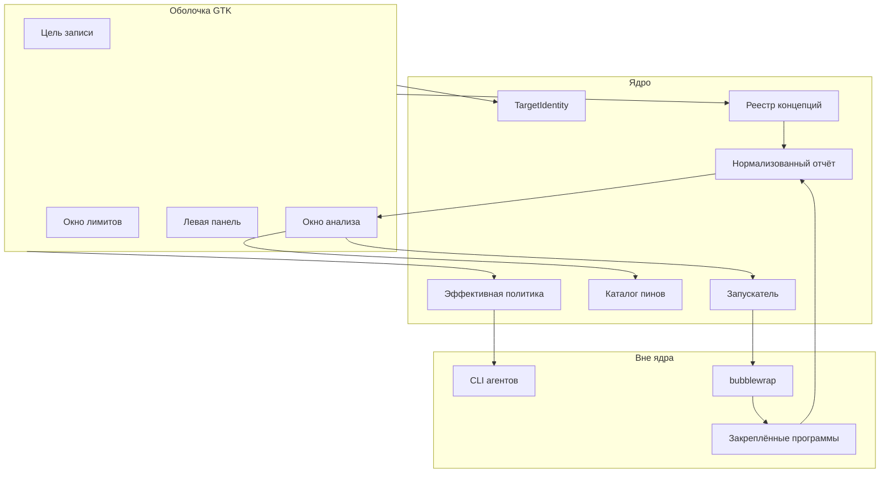
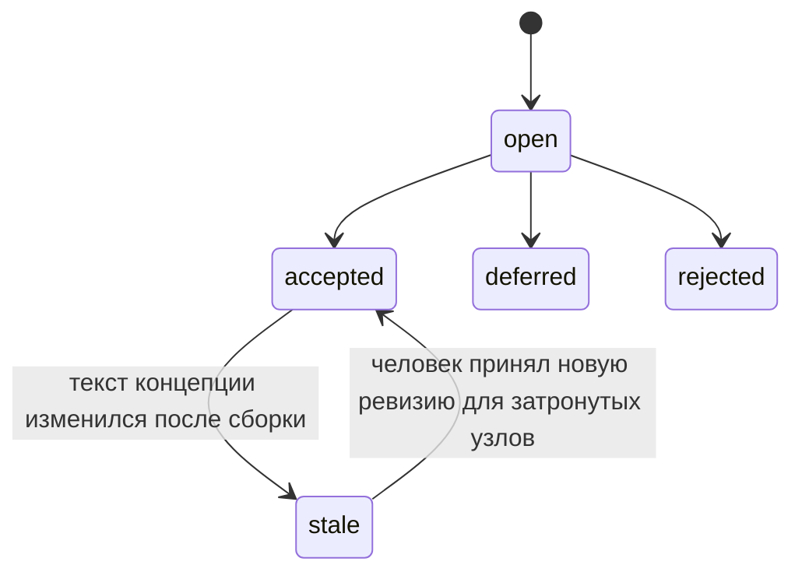
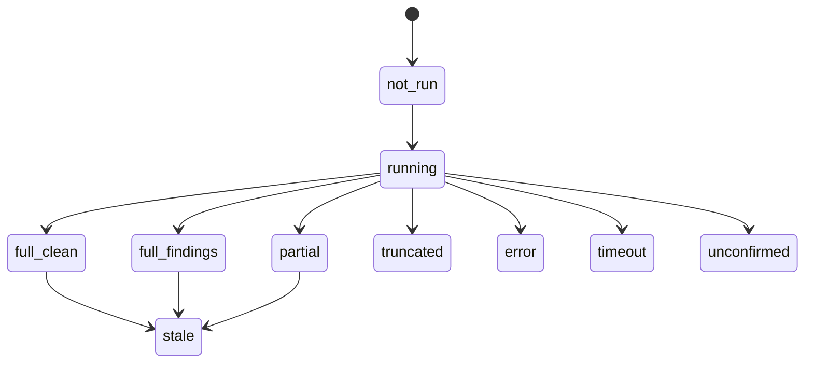

# AConsole 0.1.5+b — архитектурный план

**Состояние:** расширенный план-концепция. Это ещё не граф PlanBoard и не разрешение начинать работу.  
**Срез:** 2026-11-22.  
**Источник решений:** [0.1.5+b-concepts.md](0.1.5+b-concepts.md).  
**Куда писать код и будущий граф:** основной checkout `/home/sas/Projects/sp_aconsole_prototype`, версия исходников `0.1.5+a`. Worktree `0.1.4+d` и замороженные планы `0.1.4` в этот выпуск не входят.

Исполняемый граф создаётся после реестра концепций. Пока его нет, `plan_save` с полем `nodes` заменяет весь черновик, а в режиме вкладки `execute` методы записи плана скрыты. Этот файл — модель, по которой тот граф потом режется на узлы с путями, приёмкой и проверками.

## 0. Закрытые решения

- В выпуск входят анализ, реестр концепций, идентичность цели записи, разрешения агентов, оболочка (нижняя карточка, левая панель, шапка), окно лимитов, окно анализа, повторная проверка дефектов раздела 1 концепции и единая версия пакета.
- Порядок — одни ворота. Следующая группа функций считается неготовой, пока предыдущая не принята: идентичность и дефекты → реестр концепций → разрешения и доверие → запускатель анализа → интерфейс → версия и пакет.
- Доказательство анализа даёт закреплённая программа, а не расширение внутри VSCodium. Запускатель передаёт конфиг проекта, версию, снимок файлов и забирает нормализованный отчёт. Процесс программы ограничивается bubblewrap. Браузер и отдельный Rust-рантайм в выпуск не входят. Ruff и rust-analyzer используются как готовые программы.
- Базовый профиль Python — Ruff и Pylint вместе. Проверка типов — дополнительный профиль того же языка. Кандидат по умолчанию — закреплённый CLI basedpyright (MIT). Если проект уже выбрал Pyright своим конфигом, читается этот конфиг и в отчёте назван фактический проверяльщик.
- Языки: Python, TypeScript/JavaScript, Rust, C/C++. Приёмка — Linux x64. Другие архитектуры показываются как неподдерживаемые, без кнопки установки.
- C# в каталог не ставится, пока отдельный просмотр не прочитает `RuntimeLicenses` общинной сборки `muhammad-sammy.csharp`. Официальный `ms-dotnettools.csharp` в Open VSX отсутствует: лицензия Microsoft разрешает его в редакторах Microsoft.
- Cursor и OpenCode получают рабочее сопоставление `ask` / `allow` / `deny` с их контрактами. Неподдерживаемая комбинация до запуска объясняется и требует выбора, а не подменяется более слабым режимом.
- Файл блокировки набора в git в этот выпуск не входит. Пины живут в каталоге приложения и в пользовательском кэше неизменяемых артефактов.
- Semgrep и Bandit в базовые профили не входят. У Semgrep полный набор правил завязан на облачный вход. Публикация расширения Bandit в Open VSX не подтверждена. Для CLI-пути их можно открыть отдельной концепцией позже.

## 1. Что уже есть в 0.1.5+a

В ядре уже два контура диагностики, и они не эквивалентны.

| Контур | Где | Что доказывает |
|---|---|---|
| Индексный Ruff | `src/aconsole/core/infrastructure/codegraph/project_lint.py` | Прогон закреплённого Ruff по неизменяемому набору входов. Временный каталог получает исходники и найденные `pyproject.toml` / `ruff.toml` / `.ruff.toml`. Состояния: `clean`, `findings`, `no_targets`, `unavailable`, `timeout`, `tool_error`, `stale`. Есть хэш файла, ревизия, усечение и страница. |
| VSIX-мост | `analyzers/service.py`, `analyzers/runtime.py`, `analyzers/catalog.py` | Code OSS под `xvfb`, частный профиль, расширения Ruff `2026.98.0` и Pylint `2026.8.0` для linux-x64. Настройки форсируют `useBundled` и интерпретатор `/usr/bin/python3`. Пустой ответ без ошибки моста становится `unconfirmed`. Лимит моста — 100 сообщений. Конфигурация в MCP подписана как `bundled_defaults`. |

Модель 0.1.5 берёт форму отчёта и страницы у индексного Ruff и распространяет её на несколько программ. VSIX-мост перестаёт быть источником доказательства. Песочница Chromium у управляемого Code OSS остаётся свойством оставляемого хоста: распакованный в каталог данных бинарник не может нести setuid-помощник, а на Ubuntu 24.04/26.04 user namespace для такого бинарника режет AppArmor. Чинить этот запуск в 0.1.5 не требуется, потому что доказательный путь больше не поднимает Electron.

`ApprovalPolicyChoice` сегодня общий или проектный. Проектный выбор заменяет и режим, и подрежим опасных вызовов. Режима на агента нет. `scenario` хранится и считается как `ask`. Менять политику может только UI.

Окно лимитов уже знает дневную модель: `DailyUsageView.day` — полночь UTC, у модели есть input, output, cache read, cache write и стоимость, если источник её дал. Пропущенный день — неизвестный расход, не ноль. Диалог фиксирует ширину 850 px и левую колонку 245 px. График не выбирает день.

## 2. Модель системы

Четыре границы, которые нельзя смешивать:

1. **Идентичность копии.** Операция знает, какой checkout она меняет. Контейнер агента, worktree и установленный пакет — разные цели.
2. **Политика агента.** Она решает, как CLI агента спрашивает разрешение. Она не изолирует анализатор.
3. **Отчёт анализа.** Его пишет программа по снимку. Расширение VS Code и песочница окна Electron в эту цепочку не входят.
4. **Ограничение процесса анализа.** bubblewrap прячет домашний каталог и сеть у самой программы. Это другая граница, чем песочница Chromium: та нужна Electron, чтобы стартовали его процессы-рендереры. Расширения VS Code и так исполняются с правами пользователя.

## 3. Модель цели записи

`TargetIdentity` — значение, без которого запись не начинается.

| Поле | Смысл |
|---|---|
| `project_id` | Проект AConsole |
| `worktree_id` | Конкретная рабочая копия, если она есть |
| `logical_root` | Путь, который видит пользователь и вкладка |
| `canonical_root` | `realpath` этого корня |
| `git_common_dir`, `head`, `branch` | Git-идентичность. Для не-git проекта поля пустые и это явно показано |
| `kind` | `checkout`, `managed_worktree`, `container_mount`, `installed_package` |
| `generation` | Меняется, когда корень, HEAD или kind сменились в середине операции |

Функции:

- `resolve_target(tab) -> TargetIdentity | Ambiguous`. Несколько корней, symlink, выводящий `canonical_root` за заявленный проект, или расхождение mount контейнера и host-пути дают `Ambiguous`. Запись при `Ambiguous` не выполняется.
- `preview_write(target, path) -> WritePreview`. Показывает цель и абсолютный путь до первой записи. UI и MCP показывают один и тот же preview.
- `commit_write(target, path, bytes, expected_generation) -> WriteReceipt`. Смена `generation` отменяет запись. Квитанция содержит абсолютный путь, project/worktree id и ревизию содержимого.
- `reread(receipt) -> Confirmed | Diverged`. Надпись «сохранено» ставится только из `Confirmed`.

Журнал операции хранит исходную цель, фактическую цель, причину выбора, изменённые файлы и результат повторного чтения. Смена worktree в середине операции создаёт новый `TargetIdentity` и заново вызывает `preview_write`. Межкопийный перенос в этом выпуске не появляется: приём результата изолированного исполнителя остаётся прежним git-потоком, а не общей функцией «запиши туда же».

Вкладка связана с одной рабочей копией. Зарегистрированный проект при работе через чужой worktree показывается отдельной целью, а не подменяется основным checkout. План в базе приложения и Markdown в git — две разные записи на экране: у каждой свой `TargetIdentity`.

## 4. Модель реестра концепций

Концепция не разрешает запускать работу. Исполняемый узел создаётся только из концепции со статусом решения `accepted`.

Сущности:

- `ConceptDocument` — один документ на проект и редакцию (`0.1.5+b`): монотонная `revision`, заголовок.
- `Concept` — ключ внутри документа: цель, наблюдения, источники, предположения, альтернативы, риски, зависимости, статус, выбранный вариант, обоснование.
- `ConceptRevision` — неизменяемый снимок после успешной записи.
- `Materialization` — связь `concept_revision` с `plan_id` и ключами узлов. Повтор той же ревизии возвращает тот же план и не создаёт вторые ключи. Существующий `plan_add_nodes` уже оставляет занятый ключ как есть; сборка пользуется им, а не полной заменой через `plan_save`.
- Узел хранит `concept_key` и `concept_revision`. Смена концепции после сборки помечает связанные узлы `stale` и не переписывает их контракт сама.

Функции, все с `expected_revision`:

- `concept_get`, `concept_put` одного ключа, `concept_decide`, `concept_impact`, `plan_materialize`.
- Конфликт ревизии возвращается вызывающему. Повтор `concept_put` с тем же телом и той же ревизией идемпотентен.
- `plan_materialize` отказывается собирать ключи в статусе `open`.
- История решений, попыток и завершённых узлов при правке черновика сохраняется. Удаление чернового узла не удаляет попытки уже завершённого узла с тем же ключом.
- Методы видны MCP в режиме `plan`. Режим `execute` по-прежнему не пишет план.

Первая запись реестра — этот комплект концепций, новым планом `AConsole 0.1.5`. Идентификатор проекта и worktree при сборке совпадают с `TargetIdentity` основного checkout.

## 5. Модель разрешений агента

Слои, от более общего к более конкретному. Побеждает самый конкретный заданный слой. Сохранение общего значения не записывает его внутрь агентского профиля.

| Слой | Когда побеждает |
|---|---|
| Общий | Агент наследует общее, и проект ничего не переопределил |
| Проектный общий | Агент наследует общее, у проекта есть своя политика |
| Профиль агента | Агент не наследует общее |
| Проектный профиль этого агента | Задан явно |

`effective_policy(agent) -> PolicyView` возвращает режим, подрежим опасных действий, источник слоя, поддержан ли режим этой версией CLI и текст причины. Экран разрешений показывает это до сохранения. Строки: Claude, Codex, OpenCode, Cursor.

`scenario` остаётся хранимым синонимом `ask`, пока для него нет отдельной реализации.

### 5.1. Что AConsole уже решает сам

`verdict(choice, tags)` в `approval_policy.py`: `deny` запрещает вызов; `allow` при пустых метках или при `dangerous=allow` разрешает; иначе вопрос. Метки ставит классификатор AConsole. У Cursor и OpenCode этого классификатора внутри их CLI нет. Поэтому комбинация `allow` + `dangerous=ask` переносится не полностью.

Правило честности: если выбранный режим нельзя выполнить на этом CLI без подмены, запуск этого агента останавливается до старта. Диалог называет причину и предлагает поддерживаемый `ask` либо отмену. Остальные агенты этой остановкой не затрагиваются.

### 5.2. Cursor

Контракт CLI на 2026-11-22, по документации Cursor:

- Конфиг `~/.cursor/cli-config.json`, схема `version: 1`. Проектный файл `/.cursor/cli.json` задаёт только `permissions`.
- `approvalMode`: `allowlist`, `auto-review`, `unrestricted`.
- `permissions.deny` побеждает allow и сохраняется при `--force`. Командная политика может запретить `--force`.
- `auto-review` гоняет неизвестные вызовы через облачный классификатор. Документация Cursor прямо считает его способным ошибиться в обе стороны. Это не граница безопасности AConsole и не место показа вопроса AConsole.
- Песочница shell Cursor (`--sandbox enabled`) ограничивает команды терминала агента. К отчёту Ruff она отношения не имеет.

Сопоставление:

| Выбор AConsole | Что получает CLI Cursor |
|---|---|
| `ask` | Без `--force` и без `unrestricted`. Остаются собственные вопросы CLI. `approvalMode=allowlist`, чтобы неизвестное спрашивало, а не уходило в классификатор. |
| `deny` | `permissions.deny` на shell, запись, MCP и web fetch в объёме, который CLI умеет выразить. `unrestricted` не ставится. |
| `allow` + `dangerous=allow` | `approvalMode=unrestricted` только если пробный запуск данной версии CLI это принимает. Иначе запуск останавливается с причиной. Списки `deny`, заданные человеком в CLI, не стираются. |
| `allow` + `dangerous=ask` | Неподдерживаемая комбинация: классификатор AConsole в CLI не встраивается. Старт не выполняется, пока человек не выберет `ask` или полный `allow`. |

Пробник версии читает `agent --version` в контейнере вкладки и запоминает, какие режимы эта версия подтвердила. Непроверенная версия умеет `ask`. Автоматические режимы на ней не включаются молча.

Запись конфига идёт в домашний каталог агента внутри его контейнера, тем же приёмом, что и текущий `mcp.json`: без симлинка, атомарно, режим файла `0600`. Чужие ключи конфига сохраняются.

### 5.3. OpenCode

Контракт v2: упорядоченный список `permissions` из `action`, `resource`, `effect`. Побеждает последнее совпадение. Нет совпадения — `ask`. Отдельный список `policies` двоичный, не спрашивает и перебивает permissions и сохранённые одобрения. `tool.use` с `allow` сам доступ не выдаёт, он только снимает более ранний `deny`.

Встроенные действия, которые сопоставление обязано покрыть: `read`, `edit`, `glob`, `grep`, `shell`, `subagent`, `skill`, `webfetch`, `websearch`, `external_directory`, имена MCP-инструментов, `execute`. Имя MCP сохраняет дефисы. Правило, которое их стирает, не совпадёт и оставит действие открытым.

Текущий код уже пишет такой документ в `OPENCODE_CONFIG_CONTENT` и для `deny` добавляет policy `tool.use *`. Пускает это только при точной строке версии `opencode v2.1.2` и живом порте ingest. Точная строка заменяется проверкой способности: CLI принимает документ v2 (`permissions` массивом и `policies`). Неспособность при автоматическом режиме останавливает запуск с текстом версии, которую увидели.

| Выбор AConsole | Документ OpenCode |
|---|---|
| `ask` | MCP-сервер AConsole добавляется. Правила разрешений AConsole не подменяют собственную политику OpenCode. Нативный вопрос остаётся вопросом CLI. |
| `deny` | Policy `tool.use` на действия инструмента с `deny`, плюс хвостовое правило permissions `deny`. Policy нужна потому, что одного permissions-правила недостаточно против уже сохранённого одобрения. |
| `allow` + `dangerous=allow` | Хвостовое `allow` на действия инструментов. Policy-запрет AConsole при этом не добавляется: человек выбрал полный допуск. |
| `allow` + `dangerous=ask` | Та же честная остановка, что у Cursor, пока классификатор AConsole не связан с событием разрешения OpenCode. Узкий список «разрешить pwd и git status» сам по себе выдавать за этот подрежим нельзя: он тихо ослабляет выбранный `allow`. |

Автоматический режим требует живой ingest: без потока событий ядро не видит, что политика применилась. `ask` может стартовать без ingest, как и сейчас, когда порт отсутствует и режим не автоматический.

### 5.4. Claude и Codex

Их сопоставление уже есть в запускателях. Новая модель добавляет им тот же экран источника политики и ту же остановку вместо тихой подмены. Проверка Claude остаётся порогом версии `>=2.1.295`. Проектное переопределение проходит через таблицу слоёв из начала раздела, а не через нынешнюю полную замену всех агентов одним проектным значением.

Миграция сохраняет текущие общие значения. Агенты, у которых автоматический режим не подтверждён, получают явную строку «наследует общее, эффективный запуск будет остановлен, если общее равно allow или deny». Миграция не записывает им скрытый `ask`.

## 6. Модель каталога и пресета

- `ToolPin`: ключ, роль в профиле, версия, платформа `linux-x64`, SHA-256, лицензия, издатель, команда версии, команда проверки, адаптер отчёта, нужен ли интерпретатор или компиляционная база, пишет ли в дерево проекта, нужны ли сеть и скрипты сборки.
- Кэш: один неизменяемый файл на идентификатор, версию, платформу и хэш. Скачивание повторяется, только если хэш не сошёлся. Удаление версии возможно после проверки, что ни один открытый анализ её не держит.
- Выбор проекта хранится в базе AConsole и привязан к каноническому проекту и worktree: включённые профили, согласие на запуск, последняя проверка, личные переопределения. При открытии проекта версия сама не меняется. Обновление кэша и смена выбранного пина — разные действия.
- Профиль собирается целиком. Если хотя бы одного пина нет для linux-x64, профиль в состоянии `unsupported` и не предлагает установку. Совместимость одного «главного» расширения не делает профиль доступным.
- Уровни из концепции сохраняются как имена профилей: `base`, `strict`, `security`, `memory`. В 0.1.5 наполнены `base` у четырёх языков и типовой профиль Python. `security` для Rust может сослаться на закреплённый `cargo audit`, если пин и лицензия приняты отдельным решением внутри тех же ворот каталога. `memory` для C/C++ описывает санитайзеры как динамический профиль и в быстрый проход не входит.

Состояния установки пина: `missing`, `installing`, `ready`, `update_available`, `verifying`, `partial`, `error`, `unsupported`, `cache_miss`. Занятость не отображается как `ready`. Отмена установки оставляет прежний готовый пин, если он был.

## 7. Модель прогона анализа

### 7.1. Снимок

`AnalysisSnapshot` фиксируется в начале прогона: `TargetIdentity`, revision индекса, HEAD, перечень запрошенных путей, хэш каждого взятого файла, хэши прочитанных конфигов. Изменение файла после старта не переписывает снимок. Результат, чей revision разошёлся с текущим индексом, получает состояние `stale`. Так уже делает `analyzer_diagnostics`.

Два способа показать дерево программе:

| Способ | Когда |
|---|---|
| Частная копия входов и конфигов | Программе достаточно файлов и конфига. Так сегодня работает индексный Ruff. |
| Bind корня worktree только для чтения | Программе нужен интерпретатор, `node_modules`, `target` или `compile_commands.json`. Копия дерева ломает импорты, что уже видно на Pylint. |

Запись программы в проект не входит в снимок. Кэш программы — отдельный временный каталог. Для Cargo это `CARGO_TARGET_DIR` вне дерева. Флаг применения исправлений ни один адаптер не передаёт.

### 7.2. Ограничение процесса

Профиль bubblewrap для статического прогона:

- вызывается `/usr/bin/bwrap` из пакета дистрибутива, если он есть и сам создаёт user namespace;
- `--die-with-parent`, новый экземпляр на прогон, `PR_SET_NO_NEW_PRIVS` остаётся включённым, как это делает сам bwrap;
- в песочницу видны программа, её библиотеки, корень проекта только для чтения и временный каталог для кэша;
- домашний каталог, сокеты агента и сеть в статическом профиле не видны;
- среда очищается и собирается заново: путь к программе, язык, временный каталог, переменные, которые адаптер назвал нужными.

bwrap и песочница Chromium оба опираются на user namespace. На машине, где распакованный VSCodium не стартует, пакетный `/usr/bin/bwrap` может стартовать, потому что профиль AppArmor у него свой. Если и bwrap не может создать namespace, прогон недоверенного проекта не начинается. Доверенный проект показывает состояние `confinement_unavailable` и ждёт отдельного согласия на запуск без bwrap. Тихого перехода нет.

Скрипты сборки Cargo и компиляторные плагины исполняют код проекта. Статический профиль их не обещает. Профиль `build` существует только у доверенного проекта, с тем же bwrap, но с явным списком того, что программе можно писать во временный каталог. Недоверенный проект этот профиль не получает.

Отмена посылает группу процессов и дожидается завершения. Зависший дочерний процесс оставляет прогон в `error`, а не в успешном завершении. Это закрывает тот же класс ошибки, что и игнорирование orphan при остановке sidecar.

### 7.3. Состояния отчёта

Пустой список замечаний становится `full_clean` только вместе с доказательством завершения адаптера. Иначе состояние `unconfirmed`. `truncated` означает, что программа или страница отрезала хвост; в объекте отчёта есть продолжение, а не флаг «ровно 100, значит всё». `partial` означает, что часть целей не проверена: нет в компиляционной базе, не читается, исключена конфигом. Эти файлы перечислены. `error` и `timeout` не прячутся за нулём замечаний.

Поля отчёта, которые видят UI и MCP одинаково: инструмент, версия, адаптер, хэш пина, идентичность конфига, revision снимка, запрошенные и проверенные пути, непроверенные пути с причиной, состояние, страница замечаний, признак устаревания.

### 7.4. Нормализованное замечание

Адаптер объявляет систему координат своего JSON. В хранимом замечании линия начинается с 1, колонка — в единицах UTF-16, как уже обещает MCP (`column_units=utf16_code_units`). Рядом лежит исходная координата адаптера. Фикстура на каждый адаптер проверяет перевод.

Общие поля: путь внутри снимка, диапазон, код правила, серьёзность, текст программы без переписывания, имя инструмента, уверенность если программа её дала, доступный fix как данные, а не как применённое изменение. Фрагмент кода для модели читается тем же `index_read` по revision снимка. Текст программы и пояснение модели хранятся разными полями.

Внутренний формат — свой. SARIF удобен как экспорт там, где программа его уже пишет (у Ruff есть `--output-format sarif`), но cargo, tsc и pylint говорят иначе. Тащить конвертеры `sarif-rs` в критический путь не нужно.

## 8. Адаптеры программ

Каждый адаптер задаёт команду, код выхода, который считается доказательством, и разбор stdout. Ненулевой stderr при нулевом и «успешном» stdout даёт `unconfirmed`, а не `full_clean`.

### 8.1. Python, профиль base

Ruff: `ruff check --output-format json` по корню снимка, без `--fix`. Конфиг ищется самим Ruff от корня проекта. Код выхода 0 и разобранный пустой массив — `full_clean`. Код 1 и массив — `full_findings`. JSON Ruff использует линии и колонки с 1. Сеть не нужна. Частная копия достаточна, если в неё положены те же конфиги, что находит индексный прогон.

Pylint: `--output-format=json2` выбран потому, что старый `json` не отдаёт конец диапазона. Интерпретатор — тот, который удовлетворяет `requires-python` проекта, из окружения этого worktree. Bind корня и этого интерпретатора. Если подходящего интерпретатора нет, состояние `error` с причиной, а не прогон системного `/usr/bin/python3`. Код выхода Pylint — битовая маска категорий; аварийное завершение и usage-ошибка отделяются от «есть замечания». Замечания Ruff и Pylint об одном месте остаются двумя записями с разными источниками. Интерфейс не называет их независимым подтверждением одной ошибки.

Оба инструмента читают проектный конфиг. Расхождение с `pyproject.toml` делается видимым: в отчёте указан хэш конфига, который реально попал в прогон.

### 8.2. Python, профиль типов

Команда basedpyright с `--outputjson`. Форма ответа совпадает с Pyright: `generalDiagnostics`, `summary.filesAnalyzed`, `errorCount`, `warningCount`. Линии и колонки в этом JSON с нуля. `summary.filesAnalyzed` входит в доказательство полноты. Если в проекте есть `pyrightconfig.json` или `[tool.pyright]`, отчёт называет Pyright-конфиг и запускает тот CLI, который пин профиля сопоставил этому конфигу. Два проверяльщика одновременно базой не ставятся.

### 8.3. TypeScript

База: `tsc --noEmit --pretty false --incremental false -p <tsconfig>`. Сообщения разбираются из текста `файл(линия,колонка): error TSxxxx`. Отдельного JSON у tsc нет. Код 0 — завершённая проверка. Отсутствие tsconfig — `error` с объяснением, не пустой успех. Проверяется тот же tsconfig и тот же набор файлов, который указан в нём. `--build` в базу не входит: он другой режим и может писать вывод.

Строгий профиль: ESLint с `typescript-eslint` и типовой информацией, формат JSON (`-f json`). В отчёте видна цена: нужен type information, время отдельно от `tsc`. Плоский конфиг `eslint.config.*` определяется до запуска. Старый `.eslintrc` поддерживается только если он реально есть и версия ESLint его ещё читает; иначе `error` с именем найденного файла.

### 8.4. Rust

База доверенного проекта: `cargo check --message-format=json` и `cargo clippy --message-format=json`. Берутся сообщения `compiler-message`. При наличии `Cargo.lock` добавляется `--locked` и `--offline`, чтобы прогон не решал зависимости заново. Без lockfile состояние `partial`: сказано, что разрешение зависимостей не выполнено. `CARGO_TARGET_DIR` указывает во временный каталог. Скрипты сборки и proc-macro исполняются, поэтому недоверенный проект этот профиль не запускает.

`cargo audit` — отдельный профиль безопасности, после принятия пина. Miri в быстрый проход не входит: это динамическая проверка nightly и она не доказывает отсутствие всех ошибок.

### 8.5. C и C++

База: `clang-tidy -p <каталог с compile_commands.json>` по выбранным файлам, без `-fix`. Диагностика читается из stdout. Файлы, которых нет в базе компиляции, попадают в непроверенные, а отчёт становится `partial`. Нет `compile_commands.json` — прогон не стартует, окно называет отсутствующий файл. Санитайзеры описаны как профиль `memory`: они требуют сборки и запуска и в этот базовый профиль не подменяются.

### 8.6. C#

Исследовательская функция, не адаптер каталога. Она читает лицензию `muhammad-sammy.csharp` (`RuntimeLicenses/license.txt` и зависимость `ms-dotnettools.vscode-dotnet-runtime`) и записывает решение концепции: отложить, либо позже рассматривать анализаторы `dotnet` SDK без VSIX. До решения пина C# в кэше нет.

## 9. Функции MCP и окна анализа

MCP и окно вызывают одни сервисы ядра. Имена ниже — роли. Точные имена методов появятся в исполняемом графе и останутся в режиме чтения для `execute`, а установка и прогон потребуют того же доверия, что и UI.

| Функция | Вход | Выход |
|---|---|---|
| `preset_list` | `TargetIdentity` | Языки, профили, пины, платформенные ограничения, причины `unsupported` |
| `preset_status` | проект, worktree | По каждому пину раздельно: установлен, включён, готов, версия, причина недоступности |
| `preset_install` | ключ пина из каталога | Прогресс, отмена, итог. Произвольный идентификатор галереи отклоняется |
| `analysis_start` | профиль, цели, revision | Идентификатор работы |
| `analysis_poll` | идентификатор | Прогресс, отмена, итоговое состояние |
| `analysis_page` | идентификатор, курсор | Страница замечаний и полнота. Курсор чужой ревизии не молчит, а возвращает ту же ошибку устаревания, что индекс |
| `analysis_excerpt` | замечание, revision | Фрагмент через существующее чтение индекса. Чужой revision не читается |

Окно анализа — рабочее место, не диалог установки расширений.

- Шапка цели: корень, HEAD или digest снимка, языки, конфиги, уверенность обнаружения.
- Пресет: язык, профиль, программы, версии, источник установки, системные зависимости.
- Запуск: весь проект, изменённые файлы или выбранный набор. Список реальных целей виден до старта. Для профиля `build` и для clang-tidy окно заранее показывает недостающий SDK или `compile_commands.json`.
- Результаты: фильтр по инструменту, серьёзности и файлу, группировка одинаковых правил, карточка с фрагментом и текстом программы.
- Полнота: отдельные строчки для охвата, непроверенных файлов, ошибки запуска, таймаута, усечения и ревизии. `full_clean` подписан как «проверка завершена, замечаний нет».
- Передача в контекст задачи копирует выбранные замечания, ограничения прогона и ссылки на строки. Пояснение модели в эту передачу не подмешивается.
- Установка и прогон не блокируют UI-поток GTK. Отмена видна в тех же состояниях, что и у работы MCP.

Автоисправление из этого окна не запускается.

## 10. Модель оболочки и лимитов

Данные лимитов уже разделены правильно: окно `QuotaWindowView` несёт процент, сброс, уровень, время наблюдения и оценку; деньги есть только если их дал источник; день истории — UTC. Меняется представление и иерархия, а не смысл полей.

### 10.1. Левая панель

Три зоны сверху вниз: выбор проекта, список вкладок, нижняя сводка. Список вкладок получает оставшуюся высоту. При низкой высоте сжимается сводка: сначала прячутся вторичные строки счетов, затем сводка сворачивается в одну строку состояния. Кнопки вкладок не ужимаются до непрожимаемого размера.

Нижняя сводка внутри делится на два блока.

- Счета. На каждый видимый счёт: имя агента, остаток или расход согласно текущему переключателю, период, время сброса, порог, источник, давность наблюдения. `used_pct is None`, скрытый агент и устаревшее наблюдение рисуются разными подписями. Ноль показывается только когда источник сообщил ноль.
- Навигация. Три действия с полными подписями «План», «Индекс», «Git». У каждого достаточный размер, доступное имя, подсказка и состояние выбранного раздела. Сокращения `IDX` и `GIT` с кнопок уходят. Кнопка настроек лимитов стоит у счетов и открывает настройки, а не подменяет открытие окна лимитов.

Шапка окна остаётся местом поиска сессий, настроек и новой вкладки. Острова управления окном не перекрывают эти действия на узкой ширине. Поиск по-прежнему раскрывается на месте заголовка и не забирает строку у списка вкладок.

Клавиатура: порядок фокуса проект → вкладки → счета → навигация. Состояния hover, active и selected различны в светлой и тёмной теме. Масштаб GTK и длинные имена обрезаются многоточием с полной подсказкой. Русские и английские подписи берутся из существующих каталогов перевода.

### 10.2. Окно лимитов

Широкий режим: список счетов на треть ширины содержимого, выбранное содержимое на две трети. Узкий режим: список и детали по очереди, с явным возвратом к списку. Колонки не сжимаются обе сразу до нечитаемого состояния. Фиксированные 850×245 заменяются этими долями.

График дневной истории строится по уже хранимым UTC-дням. Рядом с осью написана зона показа; пересчёт подписи дня из UTC в выбранную зону не сдвигает границу данных относительно провайдера. У оси есть даты и шкала. Серии одной диаграммы делят масштаб. Легенда повторяет цвет модели текстом. Выбор дня — мышь и клавиатура, соседний день, сброс выбора. Выбранный день, если он ещё есть в истории, сохраняется при обновлении.

Декомпозиция выбранного дня: счёт и агент, модель, input, output, cache read, cache write. `cost_usd` показывается в строке модели только когда поле не пустое. Отсутствующий день, день с фактическим нулём и день вне загруженного диапазона — три разные подписи. Частичная история называет свой диапазон `start_day`…`end_day`.

Типографика окна следует шрифту GTK. Заголовок, крупные числа и подписи оси задаются стилями, а не уменьшением ниже читаемого размера на HiDPI.

### 10.3. Состояния, которые макет покрывает до вёрстки

Обычная, узкая и низкая панель. Широкое и узкое окно лимитов. Пустые счета, один счёт, несколько счетов, длинные имена, ошибка обновления, критический порог. Пустая, полная и дырявая история. Большие числа. Светлая и тёмная тема, ru и en, системный масштаб. Для окна анализа дополнительно: не установлен, устанавливается, готов, идёт проверка, частичный отчёт, ошибка, не поддерживается, отмена, устаревший снимок.

## 11. Дефекты раздела 1 как следствия модели

Повторная проверка на текущем коммите `0.1.5+a` обязана пройти до того, как дефект станет узлом. Ниже — как модель их закрывает, если проверка подтвердит воспроизведение.

| Наблюдение концепции | Следствие модели |
|---|---|
| README говорит и `0.1.4+f`, и `0.1.5+a` | Ворота выпуска: одна строка версии в коде, README, имени пакета и отчёте сборки |
| Сборщик Debian берёт грязное дерево | Источник сборки — чистый коммит или явный tree hash |
| Ruff из VSIX даёт тысячи замечаний при нуле у проектного Ruff | Доказательный Ruff читает проектный конфиг, как индексный прогон |
| Pylint на `/usr/bin/python3` при требовании Python `>=3.15` | Адаптер отказывается работать неподходящим интерпретатором |
| Ровно 100 сообщений выглядят полным отчётом | Состояние `truncated` и страница; пустой список без доказательства — `unconfirmed` |
| Занятость и старый текст ошибки выглядят как успех | Состояния установки и прогона не переиспользуют прошлый успех |
| Таблица MCP на 2048 сессий вытесняет живую | Отдельный дефект ядра, не часть анализатора. В план попадает только после воспроизведения, со своим критерием |
| Ingest не замечает умерший uvicorn; orphan sidecar помечает вкладку остановленной; `--socket` трогает чужой каталог | Те же ворота дефектов. Их закрытие не раздувает модель анализа |
| `chrome-sandbox` у распакованного VSCodium | Записывается как причина ухода с Electron-хоста. Починка песочницы Chromium в выпуск не входит |

## 12. Ворота и нарезка будущего графа

Каждые ворота ниже — группа будущих узлов. Узел в графе получит ограниченные пути, негативные сценарии и команду проверки. Здесь зафиксировано, что именно узел обязан доказать.

1. **Идентичность и дефекты.** `resolve_target` отказывает на symlink за пределы проекта и на расхождении контейнерного и host-пути. Квитанция записи расходится с диском — UI не говорит «сохранено». Список дефектов раздела 1 разделён на воспроизведённые и снятые, у воспроизведённых есть сценарий.
2. **Реестр.** Один `concept_put` не затирает соседний ключ. Конфликт `expected_revision` виден. `plan_materialize` повторно не дублирует ключи и не вызывает полную замену черновика. Завершённый узел старого плана `0.1.4` остаётся замороженным.
3. **Разрешения и доверие.** Матрица `ask` / `allow` / `deny` × Claude, Codex, OpenCode, Cursor, включая неподтверждённую версию, отсутствие ingest и проектный слой. Для Cursor и OpenCode тест показывает остановку `allow+dangerous=ask` и сохранение `deny` при `--force` там, где CLI это умеет. Недоверенный проект не стартует профиль `build`. Отсутствие bwrap не приводит к тихому обычному `exec`.
4. **Каталог и прогон.** На фиксированном снимке Python базовый профиль совпадает с проектным Ruff по конфигу и не использует системный Python для Pylint. Типовой профиль отдаёт `filesAnalyzed`. TypeScript падает объяснимо без tsconfig. Rust без доверия не запускает cargo. C/C++ без `compile_commands.json` остаётся в `partial` или `error`, с перечислением дыр. C#-узел заканчивается решением концепции, а не установленным VSIX. Страница MCP отличает `full_clean` от `unconfirmed`.
5. **Интерфейс.** Макеты из раздела 10 приняты до вёрстки. После вёрстки проверяются доли 1/3 и 2/3, выбор дня и его разложение, узкая и низкая панель, темы, локали, HiDPI. Окно анализа проходит состояния раздела 10.3 на живом прогоне, включая отмену.
6. **Выпуск.** Одна версия. Пакет собран из чистого коммита или названного tree hash. Приёмка на реальном дереве linux-x64 включает отмену, недоверенный проект, отсутствующее окружение и нулевое число замечаний только в состоянии `full_clean`.

## 13. Источники моделей

- Текущие типы: `project_lint.py`, `analyzers/runtime.py`, `approval_policy.py`, `DailyUsageView` и `QuotaWindowView` в `contracts/app.py`, диалог лимитов `quota_dialog.py`.
- Ruff JSON и SARIF: [вывод Ruff](https://docs.astral.sh/ruff/configuration/). Редакторские настройки по-прежнему не источник доказательства, см. концепцию.
- Pylint `json2`: [форматы вывода](https://pylint.readthedocs.io/en/latest/user_guide/usage/output.html).
- Pyright `--outputjson` и нулевые координаты: [командная строка](https://github.com/microsoft/pyright/blob/main/docs/command-line.md).
- Cursor `approvalMode`, deny против `--force`, смысл auto-review: [конфигурация](https://cursor.com/docs/cli/reference/configuration), [режимы запуска](https://cursor.com/docs/agent/security/run-modes), [permissions](https://cursor.com/docs/cli/reference/permissions).
- OpenCode v2, последнее совпадение и policies: [permissions](https://opencode.ai/docs/permissions), [policies](https://opencode.ai/docs/policies/).
- bubblewrap всегда ставит `PR_SET_NO_NEW_PRIVS` и в актуальном Debian работает без setuid, если ядро отдаёт user namespace: [README.Debian](https://metadata.security.debian.org/changelogs/main/b/bubblewrap/stable-security_README.Debian), [user namespaces](https://github.com/flatpak/flatpak/wiki/User-namespace-requirements).
- Лицензия официального C#: [Microsoft Extension Licenses](https://code.visualstudio.com/docs/supporting/oss-extensions). Общинная сборка: [Open VSX](https://open-vsx.org/extension/muhammad-sammy/csharp).
